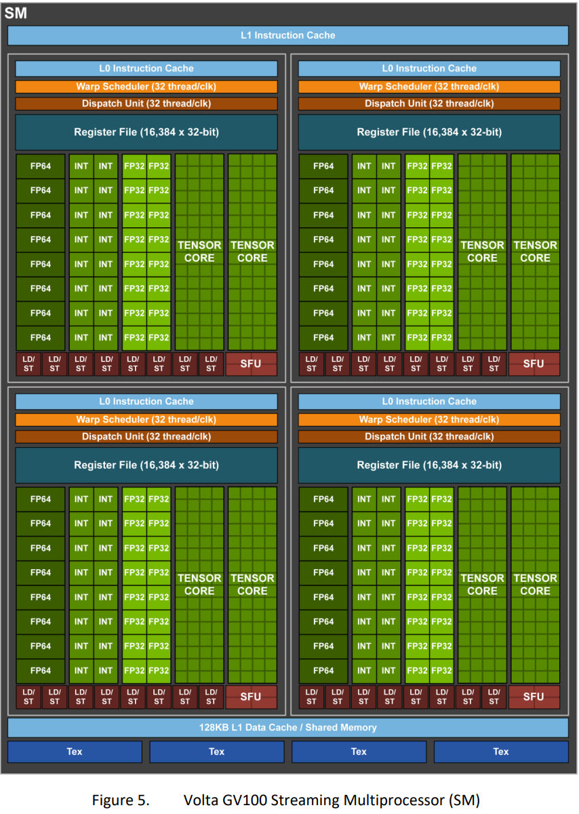

# GPU structure:
- Grid >> Block >> Threads (big to small)
- Threads in same block can interact with each other (threads in diff block cannot)
- Kernel is the function running in one grid. All threads in one grid runs the same kernel
- Parallel computing is running multiple computations across threads, blocks and grids simultaneously to speed up performance
- Pre-fetch is important, since movement between HBM and GPU registers could be one of the main bottleneck of computations

# Why learn GPU computation:
1. Processor trend: Moore's Law --> # of transistors doubles every 18-24 months
2. But we stop the frequency increase since 2005 because of heat issues
3. and we start to work towards multi-core computation / parallelism
4. 2 design approach: latency-oriented (speed for 1 task first) / throughput-oriented (multi-tasks as short as possible)
	- CPU = latency
		- few powerful ALU to reduce operation latency
		- large caches to have shorter latency cache access
		- sophisticated control (branch prediction, data forwarding)
		- modest multithreading to hide short latency (typically 2 threads per core)
		- high clock frequency
	- GPU = throughput
		- many smaller ALU with pipeline to further throughput
		- small caches to have more dedicated to computations
		- simple control
		- massive number of threads to hide the very high latency (32 / 64 threads per core)
		- moderate clock frequency

## Types of parallelism - we could apply both @ same time
1. Task parallelism: 
	- diff opn performed on same / diff data
	- usually limited amount of parallelism possible
2. Data parallelism: 
	- same opn performed on diff data
	- usually more parallelism possible --> for GPU

On CPU (host), RAM is called **host memory**;
GPU is called the device, memory is **global memory**

## To compute on GPU, we need to perform the following:
1. Alloc mem on GPU
2. Copy data from CPU to GPU mem
3. Perform computation
4. Copy data from GPU to CPU mem
5. Deallocate mem on GPU

# GPU Architecture
## Hardware
- Consists of multiple Streaming Multiprocessors (SMs)
- 1 SM has:
	- multiple cores
	- 1 shared control
	- 1 shared memory
- Cores in SM maybe organized into multiple processing blocks
- All SMs share the "global memory"
- All threads in the same block will be assigned to the same SM
    - By `assigning`, we meant reserving memory, registers and all other rsrc needed by this block. 
- 1 SM may have thread from > 1 blocks
- Threads in blocks need rsrc (registers, memory) to run
- Hence, each SM can only handle a max of number of threads

## Synchronisation
### Threads in same block can collab with one another
1. Barrier synchoronization: `__syncthread()`
    - wait for all thread in block to reach the barrier b4 any thread can proceed
2. Shared memory
    - Access fast memory for threads in the same block
3. Others

### Scheduling Considerations
- assign threads in the same block to the same SM makes collabn btwn them easy
- all threads in block assigned to SM simultaneously
    - a block cannot be assigned to an SM until it secures enuf rsrc for all its threads to exec
    - Dead lock might happen when some threads reach a barrier and others cannot exec

### Transparent Scalability
- Threads in diff blocks do not sync
- Hence, they can exec in any order / in parallel / sequentially
- Enables transparent scalability
    - same code can run on diff devices w diff amt of hardware parallelism
- Synchronizing across blocks may cause deadlock when some blocks reaches a barrier and others are not executed

### Thread Scheduling
- Threads assigned to an SM run concurrently
    - A scheduler controls this
	- Each thread has a specific memory, registers reserved for it. 
	- When swapping between threads, we dont need to save the states onto share memory, but just change the instruction each core exec
- Blocks assigned to an SM are further divided into `warps` which are the unit of scheduling
- `warps` size is device-specific, but it has always been 32 threads thus far
- a warp is processed by one processing block
- Threads in a warp are scheduled tgt & exec following the `Single Instruction Multiple Data (SIMD)` model
    - (+) Only need to fetch 1 instruction + decode once --> simplified control logic --> amortizes the cost of control across more execution units
    - (-) Different htreads taking different execution paths result in `control divergence`
	    - To handle this, warp does a `pass` over each unique execution path
		- in each pass, threads taking the path execute while others are disabled
		- % of threads/cores enabled during SIMD execution is called SIMD efficiency

### Global Memory Coalescing
GPU supports `32B`, `64B` and `128B` memory access at once. Sequential memory access by threads that are in the same warp can be coalesce into one access. 

### Latency Hiding (multi-threading in GPU cores)
- When a warp needs to wait for a high latency operation, another warp that is ready is selected & scheduled for exec
- Typically SM has more threads than cores to support latency hiding

### Occupancy
- = ration of warps/threads active (assigned) on SM to max allowed
- Generally max occupancy is preferred for better latency hiding

## Choosing numOfThreads/Block
We attempt to max occupancy. We choose a numOfThreads/Block `n`, such that when numOfThreads/SM is `k` and maxNumOfBlocks/SM = `b`: $\frac{k}{b} < b$

## Performance Metrics
| Name | What is it |
| ---- | ------- |
| FLOPS Rate | max possible floating point operaiotns per second that a processor can perform |
| Memory Bandwidth | max possible bytes per second the memory supplies to the cores |
|  |  |

## Performence bounds
1. `Compute-bound`: when performance is limited by the FLOPS rate (cores always busy)
2. `Memory-bound`: when performance is limited by the memory bandwidth (cores are waiting)

Generally, our `FLOPS >> memory bandwidth`, we will have a desired compute-to-global-memory ratio, which represents the number number operations per byte of data read from memory to peak both compute and memory usage

## Memory Architecture
Each GPU has multiple SMs & each SM has:
- Control
- Registers (`1 cycle access time`)
- Multiple cores
- a L1 Cache (`5 cycle access time`)
- Shared memory (`5 cycle access time`) 
    - managed by programmer
- Constant Cache (`5 cycle access time`)

SMs can access:
- shared global memory at around `500 cycles`
- shared L2 Cache

We have higher number of threads in GPU, hence cache eviction happens very frequently. 
- Solution: use shared memory instead of relying on L1 Cache ==> `tiling`

## CUDA Memory Model
- Each thread has their own register
- Threads in a block share one shared memory
- Global memory and Constant memory are shared by all threads in all blocks in the grid

