# RTX 3080 results overview (auto-generated)

Generated by `python -m analysis.plots`; every figure is built from existing result files, the tables below carry the same numbers.

hw_id `rtx3080_sm86_68sms_10gb` | driver 595.99.02 | torch 2.13.0+cu130 | triton 3.7.1; standard conditions (SM clock locked at 1755 MHz, 3 input placements pooled, cold L2 primary).

## Baselines

B1 `torch.matmul`, B3+ searched cuBLASLt, B5 Triton tutorial and the per-shape Triton oracle.

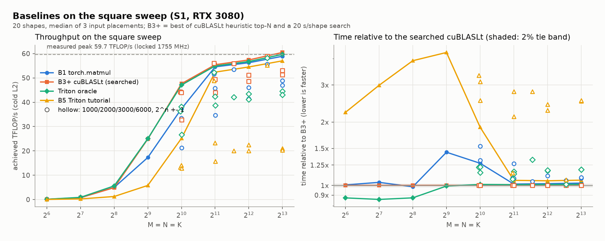

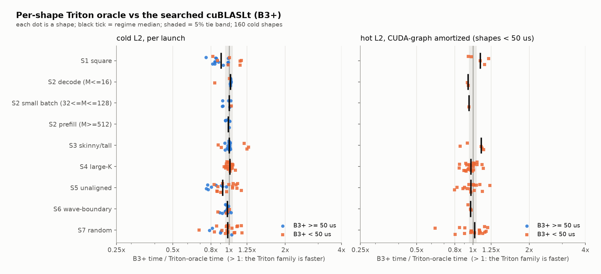

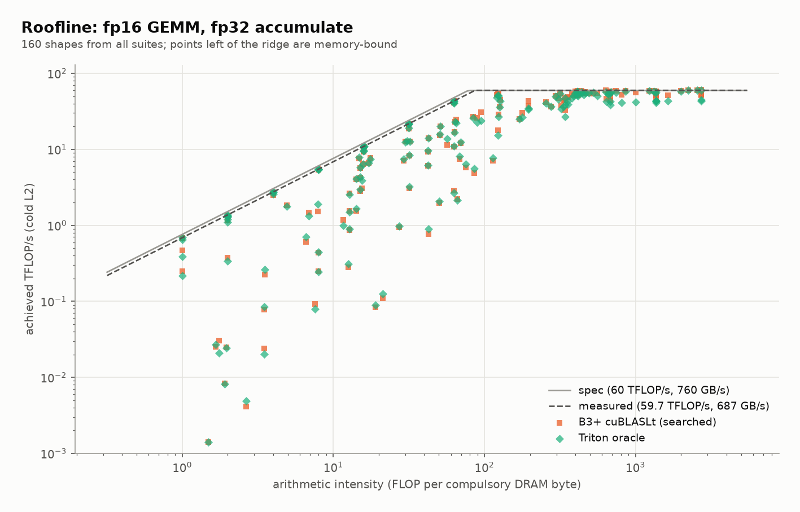

### Triton oracle vs B3+ (B3+ time / oracle time)

| mode | regime | n | median | oracle > B3+ by 5% | within 5% | oracle < B3+ by 5% |
|---|---|---|---|---|---|---|
| cold | S1 square | 20 | 0.905 | 3 | 6 | 11 |
| cold | S2 decode (M<=16) | 10 | 1.017 | 0 | 9 | 1 |
| cold | S2 small batch (32<=M<=128) | 8 | 1.003 | 0 | 5 | 3 |
| cold | S2 prefill (M>=512) | 6 | 0.991 | 0 | 6 | 0 |
| cold | S3 skinny/tall | 21 | 1.002 | 3 | 16 | 4 |
| cold | S4 large-K | 24 | 1.010 | 1 | 22 | 1 |
| cold | S5 unaligned | 23 | 0.922 | 5 | 5 | 13 |
| cold | S6 wave-boundary | 24 | 0.979 | 0 | 21 | 3 |
| cold | S7 random | 24 | 0.981 | 6 | 10 | 8 |
| graph | S1 square | 5 | 1.093 | 3 | 1 | 1 |
| graph | S2 decode (M<=16) | 2 | 0.939 | 0 | 0 | 2 |
| graph | S2 small batch (32<=M<=128) | 1 | 0.952 | 0 | 1 | 1 |
| graph | S3 skinny/tall | 5 | 1.107 | 3 | 0 | 2 |
| graph | S4 large-K | 24 | 0.973 | 4 | 11 | 9 |
| graph | S5 unaligned | 15 | 0.976 | 3 | 7 | 5 |
| graph | S6 wave-boundary | 3 | 0.971 | 0 | 2 | 1 |
| graph | S7 random | 19 | 1.018 | 9 | 5 | 5 |

Measured roofline (`data/<hw>/roofline.json`): 59.7 TFLOP/s fp16 tensor (spec at boost 59.5), 687 GB/s DRAM (spec 760). Best B3+ in the table: 60.5 TFLOP/s; best Triton oracle: 60.1 TFLOP/s.

## Noise floor

How small a difference can be trusted (ties: 2% at >= 50 us, 5% below).

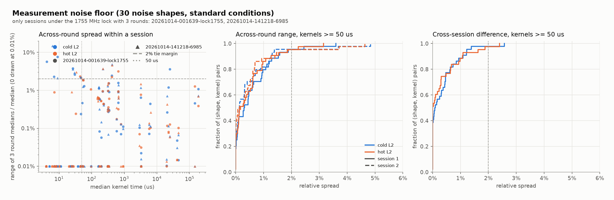

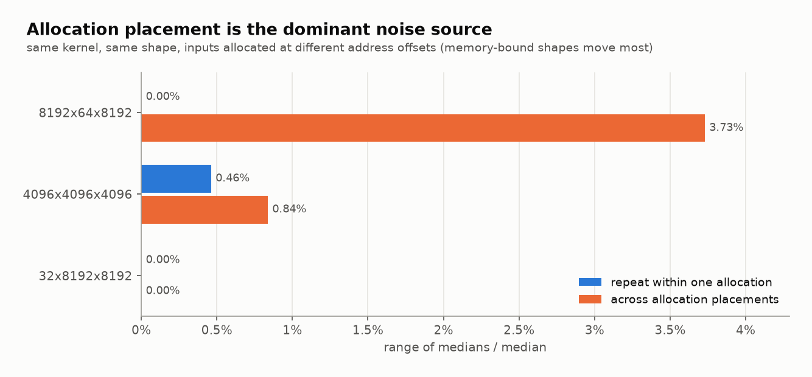

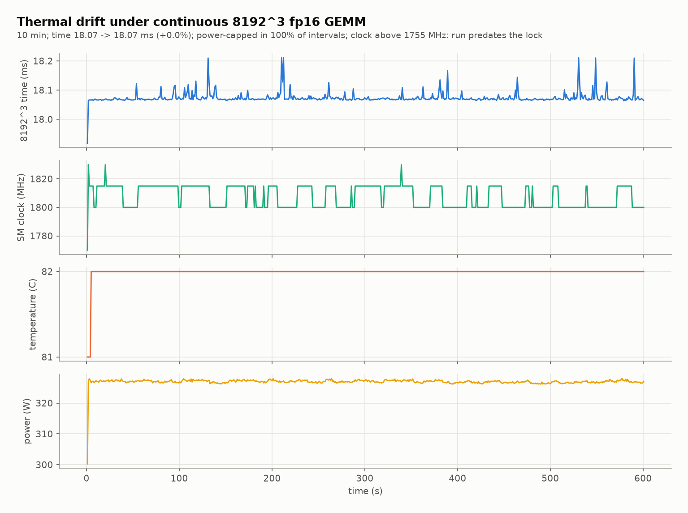

### Noise floor, kernels >= 50 us (relative spread, 0.01 = 1%)

| quantity | session | mode | n | p50 | p95 | max |
|---|---|---|---|---|---|---|
| across-round range | noise-20261014-001639-lock1755 | cold | 44 | 0.0031 | 0.0184 | 0.0360 |
| across-round range | noise-20261014-141218-6985 | cold | 44 | 0.0013 | 0.0137 | 0.0484 |
| across-round range | noise-20261014-001639-lock1755 | hot | 43 | 0.0017 | 0.0182 | 0.0316 |
| across-round range | noise-20261014-141218-6985 | hot | 43 | 0.0014 | 0.0185 | 0.0463 |
| cross-session |difference| | 639-lock1755 vs -141218-6985 | cold | 44 | 0.0009 | 0.0123 | 0.0257 |
| cross-session |difference| | 639-lock1755 vs -141218-6985 | hot | 43 | 0.0001 | 0.0158 | 0.0240 |

Sessions excluded (unlocked, different driver, or fewer than 3 rounds): noise-20261013-231817-2a31, noise-20261013-232542-642a, noise-s1-20261009, noise-s2-multialloc-20261009.

### Allocation placement (range of medians / median)

| shape | within allocation | across allocations |
|---|---|---|
| 8192x64x8192 | 0.0000 | 0.0373 |
| 4096x4096x4096 | 0.0046 | 0.0084 |
| 32x8192x8192 | 0.0000 | 0.0000 |

Thermal drift (`drift-20261009-120343.csv`): 8192^3 median 18067 -> 18069 us (+0.01%), clock 1770-1830 MHz, temp 81->82 C, median power 327 W, power-capped in 100% of intervals. **The clock moved above 1755 MHz, so this run predates the clock lock (not standard conditions).**

## Selector performance

Held-out regret against the per-shape Triton oracle, and the comparison with B3+.

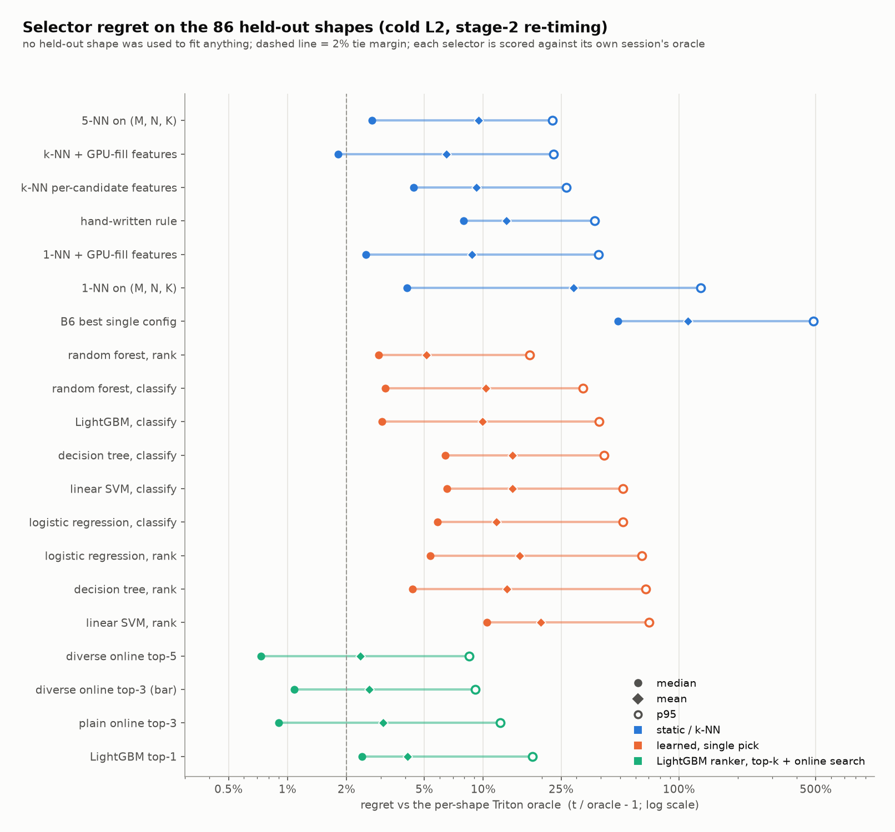

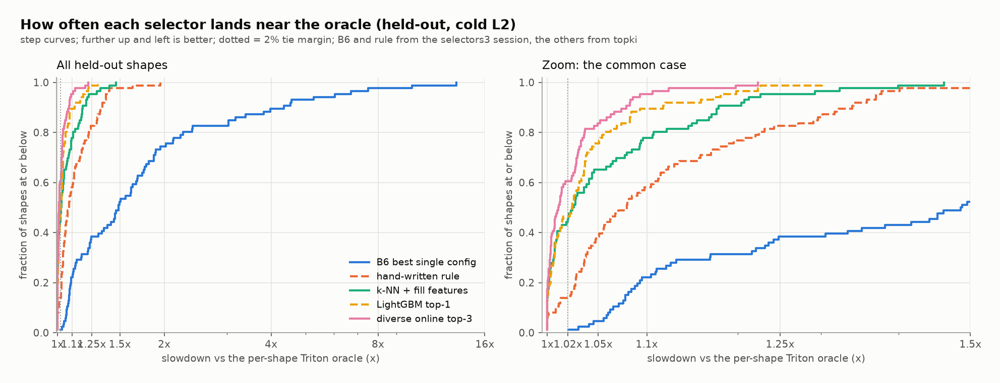

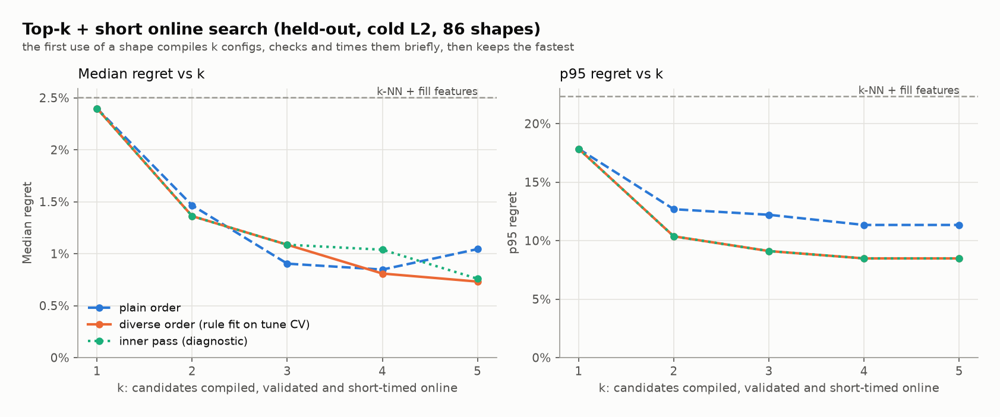

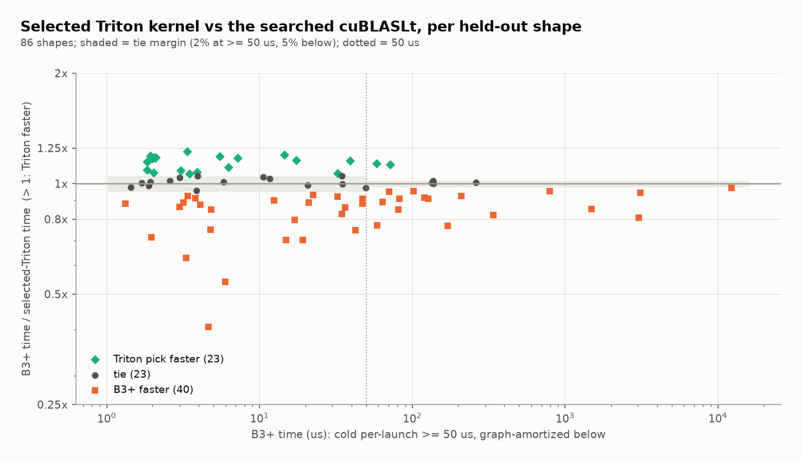

### Held-out regret, cold L2, all 86 shapes (t / oracle - 1)

| selector | family | median | mean | p95 | max | within 5% |
|---|---|---|---|---|---|---|
| 5-NN on (M, N, K) | static / k-NN | 0.027 | 0.095 | 0.226 | 2.747 | 0.628 |
| k-NN + GPU-fill features | static / k-NN | 0.018 | 0.065 | 0.229 | 0.471 | 0.616 |
| k-NN per-candidate features | static / k-NN | 0.044 | 0.092 | 0.267 | 1.212 | 0.535 |
| hand-written rule | static / k-NN | 0.079 | 0.132 | 0.370 | 0.953 | 0.384 |
| 1-NN + GPU-fill features | static / k-NN | 0.025 | 0.088 | 0.389 | 0.646 | 0.593 |
| 1-NN on (M, N, K) | static / k-NN | 0.041 | 0.290 | 1.294 | 4.671 | 0.512 |
| B6 best single config | static / k-NN | 0.487 | 1.111 | 4.858 | 12.300 | 0.047 |
| random forest, rank | learned, single pick | 0.029 | 0.051 | 0.173 | 0.340 | 0.581 |
| random forest, classify | learned, single pick | 0.032 | 0.103 | 0.323 | 1.350 | 0.570 |
| LightGBM, classify | learned, single pick | 0.030 | 0.099 | 0.390 | 1.350 | 0.570 |
| decision tree, classify | learned, single pick | 0.064 | 0.142 | 0.414 | 1.820 | 0.419 |
| linear SVM, classify | learned, single pick | 0.065 | 0.141 | 0.518 | 1.262 | 0.407 |
| logistic regression, classify | learned, single pick | 0.059 | 0.117 | 0.518 | 0.910 | 0.442 |
| logistic regression, rank | learned, single pick | 0.054 | 0.153 | 0.646 | 1.215 | 0.477 |
| decision tree, rank | learned, single pick | 0.044 | 0.132 | 0.677 | 1.436 | 0.523 |
| linear SVM, rank | learned, single pick | 0.105 | 0.197 | 0.704 | 1.013 | 0.349 |
| diverse online top-5 | LightGBM ranker, top-k + online search | 0.007 | 0.024 | 0.085 | 0.224 | 0.860 |
| diverse online top-3 (bar) | LightGBM ranker, top-k + online search | 0.011 | 0.026 | 0.091 | 0.224 | 0.837 |
| plain online top-3 | LightGBM ranker, top-k + online search | 0.009 | 0.031 | 0.122 | 0.227 | 0.791 |
| LightGBM top-1 | LightGBM ranker, top-k + online search | 0.024 | 0.041 | 0.178 | 0.301 | 0.756 |

### cold, >= 50 us

| selector | median | mean | p95 | n |
|---|---|---|---|---|
| B6 best single config | 0.785 | 1.261 | 3.938 | 30 |
| k-NN + GPU-fill features | 0.019 | 0.086 | 0.366 | 30 |
| LightGBM top-1 | 0.026 | 0.052 | 0.190 | 30 |
| plain online top-3 | 0.009 | 0.038 | 0.167 | 30 |
| diverse online top-3 (bar) | 0.010 | 0.024 | 0.100 | 30 |

### cold, < 50 us

| selector | median | mean | p95 | n |
|---|---|---|---|---|
| B6 best single config | 0.245 | 1.031 | 5.222 | 56 |
| k-NN + GPU-fill features | 0.017 | 0.053 | 0.190 | 56 |
| LightGBM top-1 | 0.023 | 0.035 | 0.118 | 56 |
| plain online top-3 | 0.010 | 0.027 | 0.084 | 56 |
| diverse online top-3 (bar) | 0.012 | 0.027 | 0.084 | 56 |

### graph-amortized, shapes < 50 us

| selector | median | mean | p95 | n |
|---|---|---|---|---|
| B6 best single config | 0.245 | 1.074 | 4.560 | 56 |
| k-NN + GPU-fill features | 0.047 | 0.073 | 0.262 | 56 |
| LightGBM top-1 | 0.025 | 0.044 | 0.135 | 56 |
| plain online top-3 | 0.004 | 0.027 | 0.123 | 56 |
| diverse online top-3 (bar) | 0.002 | 0.021 | 0.097 | 56 |

### Diverse online top-3 vs B3+ (held-out)

| regime | n | Triton faster | ties | B3+ faster | median B3+/pick |
|---|---|---|---|---|---|
| B3+ >= 50 us (cold, 2% margin) | 26 | 2 | 8 | 16 | 0.952 |
| B3+ < 50 us (graph, 5% margin) | 60 | 21 | 15 | 24 | 0.999 |

## Kernel selection statistics

Portfolio size, parameter importance, which configs win where, and what the online search does.

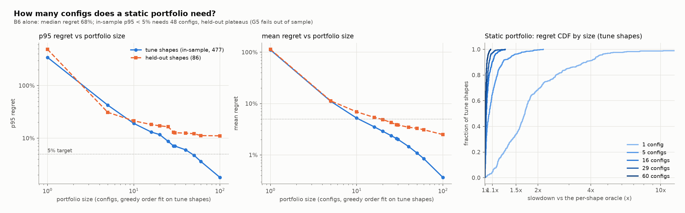

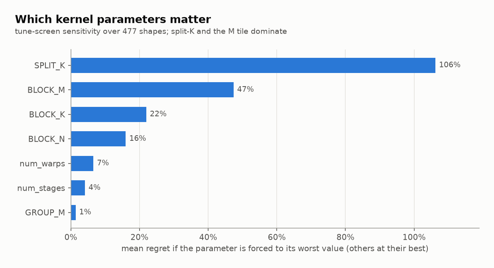

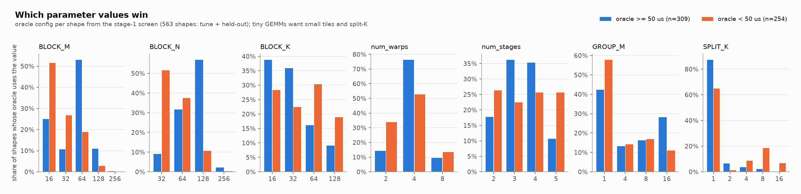

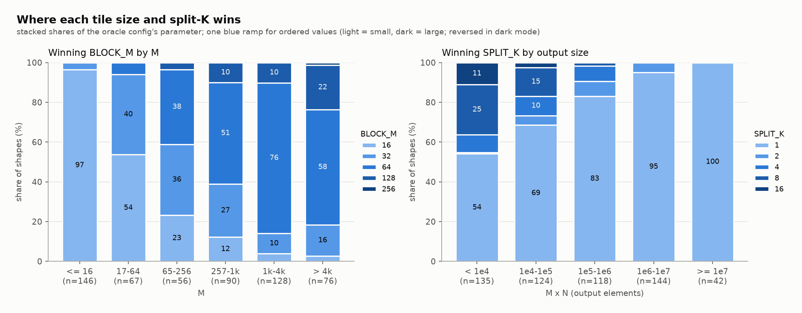

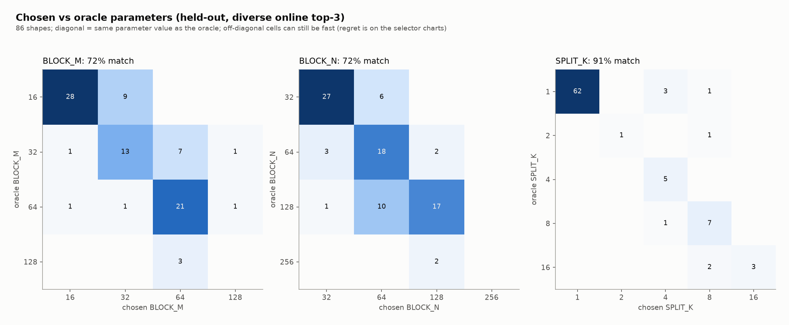

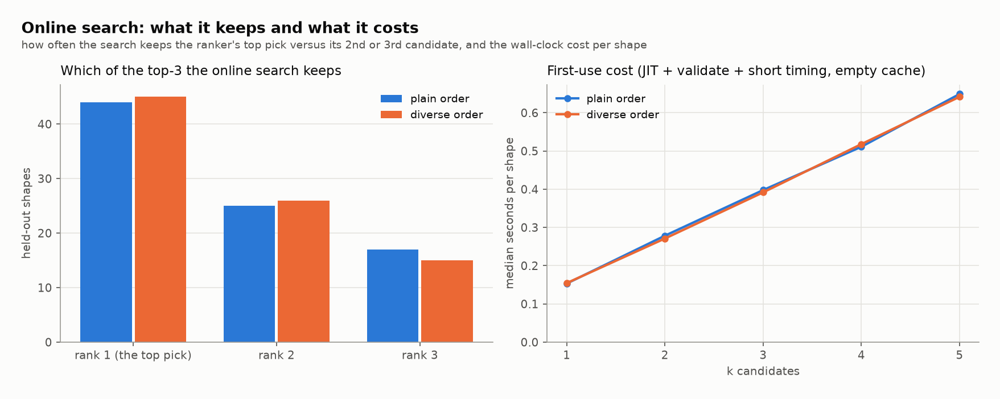

### Static portfolio (greedy, fit on tune shapes)

| size | tune mean | tune p95 | held-out mean | held-out p95 |
|---|---|---|---|---|
| 1 | 1.108 | 3.431 | 1.136 | 4.870 |
| 5 | 0.111 | 0.424 | 0.113 | 0.310 |
| 10 | 0.052 | 0.191 | 0.069 | 0.214 |
| 20 | 0.029 | 0.117 | 0.049 | 0.172 |
| 30 | 0.020 | 0.071 | 0.038 | 0.127 |
| 60 | 0.008 | 0.036 | 0.031 | 0.112 |
| 100 | 0.004 | 0.018 | 0.025 | 0.111 |

Oracle winners: 332 distinct configs win at least one of 563 screened shapes; the most common are `bm16_bn128_bk32_w4_s4_g1_sk1` (11), `bm64_bn64_bk32_w4_s3_g16_sk1` (9), `bm64_bn128_bk16_w2_s4_g16_sk1` (8), `bm16_bn128_bk16_w4_s4_g1_sk1` (8), `bm16_bn128_bk32_w4_s3_g1_sk1` (8).

Online search cost:

- plain top-3: picked rank counts [44, 25, 17], median 0.40 s per shape, 37 s over 86 shapes
- diverse top-3: picked rank counts [45, 26, 15], median 0.39 s per shape, 37 s over 86 shapes

