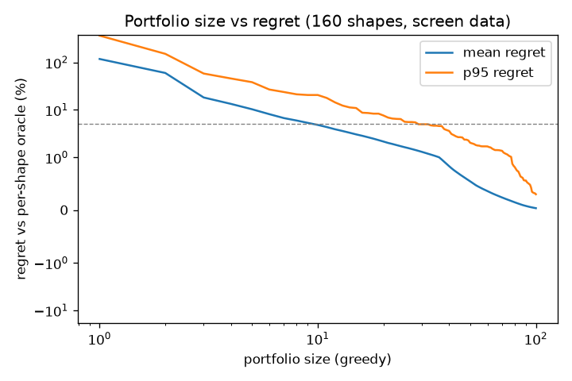

# Triton config sweep: portfolio study (auto-generated)

Source: `/home/raynerubuntu/Documents/repos/CS464/data/rtx3080_sm86_68sms_10gb/sweep_screen` | 477 shapes x 10840 configs (2558593 timed cells; pruned / invalid cells count as infinite regret).

Regret = t / per-shape oracle - 1, from **screen** times (few samples; slightly pessimistic, see module doc).

## G3: value of per-shape selection over the best single config (B6, full space)

B6 = `bm32_bn32_bk32_w4_s5_g1_sk1`. Regret of B6 vs oracle: median 68.4%, p90 275.2%, max 900.0%.

## G5: portfolio size vs regret (greedy on mean regret)

| size | mean | p50 | p95 | p99 | max |
|---|---|---|---|---|---|
| 1 | 110.84% | 68.42% | 343.09% | 1001.61% | 900.0% |
| 2 | 60.11% | 41.82% | 187.62% | 345.97% | 384.1% |
| 3 | 19.49% | 14.24% | 60.15% | 103.50% | 114.3% |
| 4 | 14.51% | 9.13% | 45.58% | 87.13% | 114.3% |
| 5 | 11.07% | 5.60% | 42.42% | 87.13% | 114.3% |
| 6 | 8.90% | 4.55% | 28.11% | 62.38% | 114.3% |
| 8 | 6.82% | 3.45% | 23.12% | 38.16% | 53.2% |
| 10 | 5.21% | 2.46% | 19.11% | 28.61% | 53.2% |
| 12 | 4.52% | 2.25% | 15.77% | 23.13% | 30.3% |
| 16 | 3.52% | 1.60% | 13.06% | 22.43% | 30.3% |
| 20 | 2.90% | 1.40% | 11.70% | 18.66% | 30.0% |
| 25 | 2.38% | 1.22% | 8.72% | 14.17% | 30.0% |
| 30 | 2.02% | 1.04% | 7.08% | 13.54% | 30.0% |
| 40 | 1.46% | 0.60% | 6.01% | 10.47% | 14.1% |
| 50 | 1.09% | 0.47% | 4.73% | 7.23% | 11.7% |
| 60 | 0.85% | 0.30% | 3.61% | 6.14% | 7.7% |
| 80 | 0.56% | 0.00% | 2.59% | 4.35% | 5.4% |
| 100 | 0.36% | 0.00% | 1.79% | 2.78% | 3.3% |

**Smallest greedy portfolio with p95 regret < 5%: 48** (G5 asks for <= ~50).

Set cover (every shape has a member within eps of its oracle): eps=2%: 102 configs, eps=3%: 79 configs, eps=5%: 59 configs

First 20 portfolio members: `bm32_bn32_bk32_w4_s5_g1_sk1`, `bm32_bn32_bk64_w4_s4_g1_sk8`, `bm64_bn64_bk32_w4_s4_g1_sk1`, `bm16_bn64_bk64_w4_s5_g1_sk1`, `bm64_bn128_bk16_w4_s4_g4_sk1`, `bm64_bn32_bk64_w8_s3_g1_sk4`, `bm16_bn32_bk64_w2_s5_g1_sk16`, `bm32_bn32_bk128_w4_s5_g1_sk1`, `bm16_bn32_bk16_w2_s4_g1_sk1`, `bm64_bn64_bk32_w4_s3_g1_sk2`, `bm128_bn32_bk64_w4_s3_g1_sk8`, `bm32_bn64_bk64_w4_s5_g1_sk1`, `bm16_bn32_bk64_w2_s5_g1_sk8`, `bm64_bn128_bk32_w4_s5_g1_sk1`, `bm16_bn64_bk32_w4_s5_g1_sk1`, `bm32_bn64_bk16_w4_s3_g1_sk1`, `bm64_bn64_bk32_w4_s5_g8_sk8`, `bm16_bn32_bk32_w2_s2_g1_sk8`, `bm32_bn32_bk16_w4_s2_g1_sk1`, `bm16_bn64_bk128_w4_s4_g1_sk1`

## Which parameters matter

Mean regret if a parameter is forced to its worst value (others chosen freely per shape), and how often each value is the best choice:

| parameter | regret at worst value | best value counts (shapes) |
|---|---|---|
| SPLIT_K | 106% | 1: 370, 2: 21, 4: 27, 8: 47, 16: 12 |
| BLOCK_M | 47% | 16: 174, 32: 80, 64: 202, 128: 20, 256: 1 |
| BLOCK_K | 22% | 16: 171, 32: 144, 64: 103, 128: 59 |
| BLOCK_N | 16% | 32: 138, 64: 192, 128: 142, 256: 5 |
| num_warps | 7% | 2: 147, 4: 288, 8: 42 |
| num_stages | 4% | 2: 118, 3: 163, 4: 123, 5: 73 |
| GROUP_M | 1% | 1: 285, 4: 69, 8: 76, 16: 47 |

