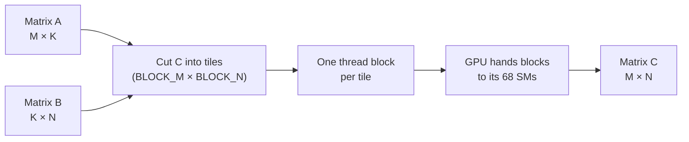
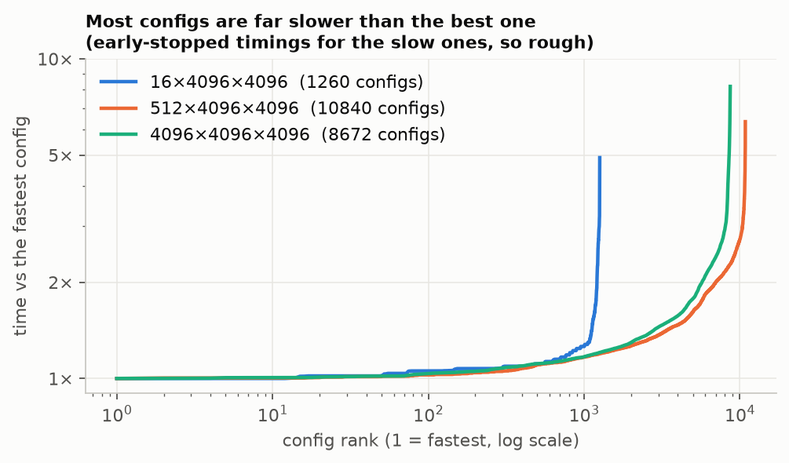

# 1. Background: what is a kernel selector, and why do we need one?

## 1.1 The job: multiplying two big tables of numbers

Almost everything an AI model does on a GPU is **matrix multiplication** (called **GEMM**).
Multiply a table **A** (M rows × K columns) by a table **B** (K rows × N columns) and you get **C** (M × N).
That costs about `2 × M × N × K` arithmetic operations. Here we use 16-bit decimals (`fp16`).

The *shape* of the job is just the three numbers **M, N, K**.
A chatbot answering one word at a time has `M = 1`. Reading a long prompt has `M = 8192`. Both are matrix multiplications, but they behave very differently.

## 1.2 How a GPU runs it

A GPU is a factory with many small workers, not one fast worker.

- The RTX 3080 we used has **68 "SMs"** (streaming multiprocessors). Each SM is a mini-processor.
- The program that runs on the GPU is called a **kernel**. The GPU cannot do the whole multiplication in one go, so the kernel cuts **C** into small square **tiles**.
- Each tile becomes one **thread block**. The GPU hands blocks to SMs. Each block loads a strip of A and B into fast on-chip memory, multiplies, and writes its tile of C.

The kernel has **settings** (we call a full set of settings a **config**). The ones we vary:

| Setting | Plain meaning | What goes wrong if it is bad |
|---|---|---|
| `BLOCK_M, BLOCK_N` | tile height and width | big tiles waste work on small matrices; small tiles reload data too often |
| `BLOCK_K` | how much of the inner size is loaded each step | too big runs out of fast memory; too small means many slow steps |
| `num_warps` | how many worker groups share a tile | too few leaves the hardware idle |
| `num_stages` | how many loads are queued ahead (a pipeline) | too few and the maths waits for memory |
| `GROUP_M` | the order tiles are visited (helps caches) | wasted memory traffic |
| `SPLIT_K` | split the long inner sum across several blocks, then add | helps when there are too few tiles to keep 68 SMs busy, but the final add costs time |

**Wave effect.** If a job makes 69 tiles and the GPU has 68 SMs, 68 tiles run first and *one lonely tile* runs second, while 67 SMs sit idle. So a tiny change in M can change speed a lot. That is why we built a whole suite around it (see [shapes](04_shapes.md)).

## 1.3 Why picking the settings is hard

For every shape there are thousands of possible configs. After removing impossible ones, our family has **10,840**.

*Each line is one shape. A config at the right end of the line is several times slower than the best one. The shapes were timed in a quick first-pass screen, so the slow end is approximate.*

And the best config **changes with the shape**:

- **332 different configs** were the winner somewhere among the 563 shapes we screened.
- If you choose **one config for everything** (the "best single config", B6), the typical unseen shape runs **49% slower** than its best, and the unluckiest 5% run **about 6× slower** (see [baselines](02_baselines.md)).

## 1.4 So what is a kernel selector?

A **kernel selector** is a small program that looks at the shape (M, N, K) and **picks the config** before running. It must be:

- **accurate**: close to the best config;
- **fast**: cheap enough to run the first time a new shape appears. Trying every config (compiling and timing thousands of kernels) is an offline, hours-long job over many shapes, which is far too slow for a program that meets a new shape while running.

Real software already has selectors: cuBLAS (NVIDIA's library) has a rule-based "heuristic". It is good but not perfect. Searching its options for 20 seconds per shape beat its default pick by more than 2% on **237 of 477 shapes**.

This project asks: **can a learned model pick Triton configs (and cuBLASLt choices) well enough to be worth using?**

## 1.5 Why results on one GPU do not carry over

A selector learns "this shape likes this config" on one GPU. A different GPU changes the answers:

| What differs | Why it matters |
|---|---|
| **Number of SMs** (3080: 68, 2060: 30) | decides where the "wave" cliffs sit |
| **Fast on-chip memory per SM** | decides which tile sizes fit at all (we prune configs that don't) |
| **Memory speed** (3080: 686 GB/s measured, 2060: 289 GB/s) | decides whether small-M jobs are limited by memory or by maths |
| **Tensor cores** (special matrix hardware) | the 3080 has ones Triton can use. With the Triton version we used, the **2060's compiled code contained no tensor-core instructions** (0 of 193 kernels), so Triton reached only 0.43× of cuBLAS there |
| **GPU memory (VRAM)** (3080: 10 GB, 2060: 6 GB) | very large shapes do not fit, and compiling many configs in parallel can run out of memory |
| **Clock speed, power cap, driver version** | change timings by a few percent, so we lock the clock at 1755 MHz and only compare runs with the same driver |

**Take-away:** the *recipe* (screen → train → race a few picks) moved to a second GPU and worked, but the *trained model* and the *numbers* must be redone per GPU (the 2060 retrain took about 10 hours of sweeping).

---
Next: [2. Baselines](02_baselines.md)
