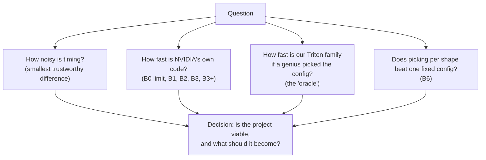
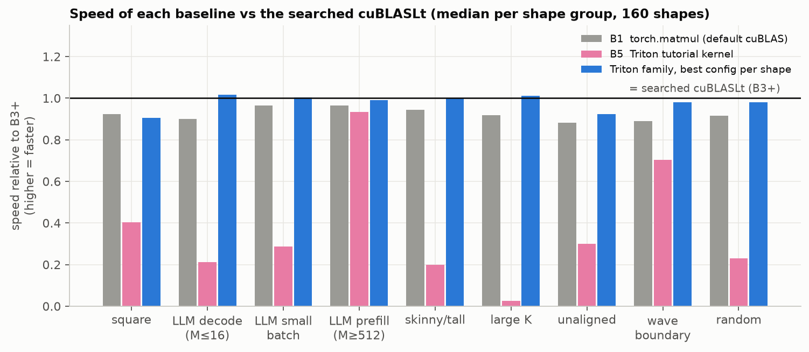
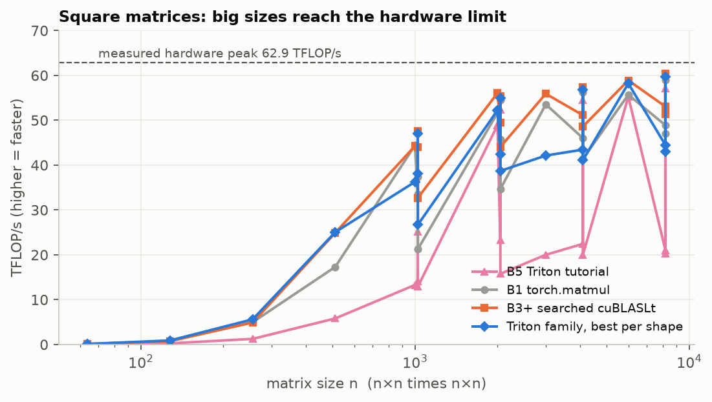
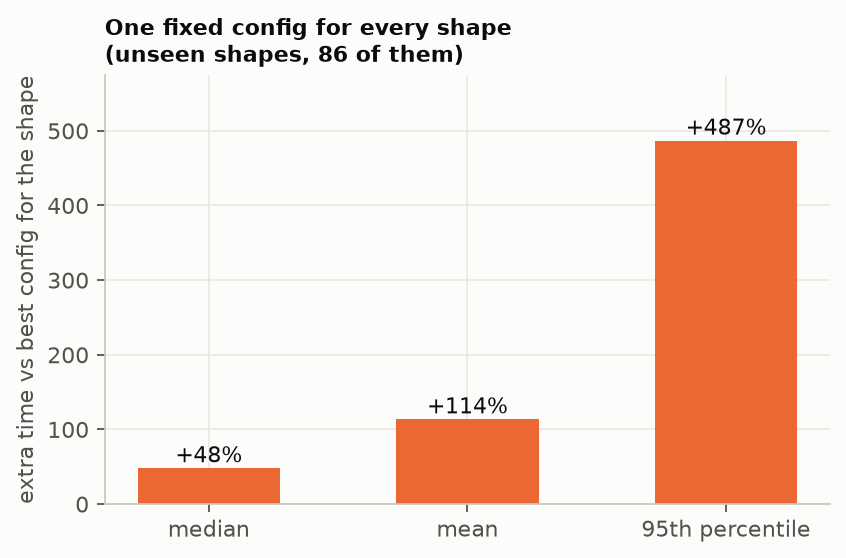
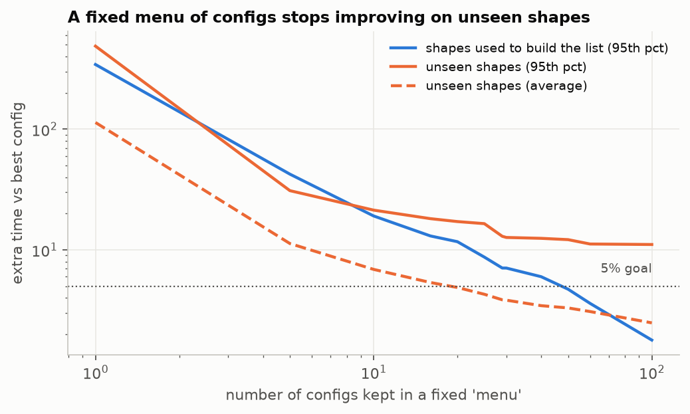
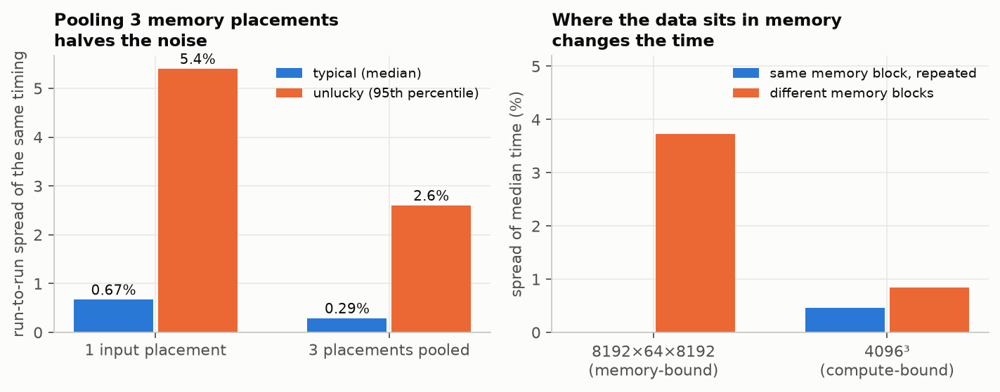

# 2. Baseline studies

A baseline is the thing we must beat, or at least match, to say a new idea is useful. Before any machine learning we asked four questions with data. All numbers are from one RTX 3080 with its clock locked at 1755 MHz (see [methodology](../docs/methodology.md)).

## 2.1 The baselines, why each exists, and what we found

| Name | What it is | Why we need it | Result |
|---|---|---|---|
| **B0 roofline** | the hardware's speed limit: maths speed and memory speed | tells us when a result is "as fast as physically possible" | **62.9 TFLOP/s** maths (spec 59.5), **686 GB/s** memory (spec 760). Under steady load the card hits its power cap |
| **B1 `torch.matmul`** | what a normal PyTorch user gets | "what people have today" | median **0.93×** of B3+ (worst 10% below 0.73×) |
| **B2 cuBLASLt default** | NVIDIA's own selector, top pick | the vendor's selector, which we are trying to match | median speed **0.93×** of B3+ (160 shapes). The worst 10% are below 0.73× |
| **B3 cuBLASLt best of its list** | time NVIDIA's top-N suggestions and take the best | a fairer "vendor with benchmarking" bar | median **0.98×** of B3+ |
| **B3+ searched cuBLASLt** | B3 plus a 20-second-per-shape search over many NVIDIA algorithm options | **the honest ceiling**. Beating a library that is not allowed to benchmark proves little | found a faster option than the default on **237 of 477** shapes. The bar we use for every "beats cuBLAS" claim |
| **B5 Triton tutorial kernel** | the example matmul that ships with Triton, one fixed config | shows what a naive Triton kernel gives | median **0.30×** of B3+ (over 3× slower). Up to **14× slower** than torch on one-row (decode) shapes |
| **Triton oracle** | our parameterised kernel, with the best of all configs picked per shape by brute force | the best any selector could ever do with this kernel | **0.99×** of B3+ (median, 160 shapes; 98.8% by the report's calculation) |
| **B6 best single config** | one config used for every shape | shows whether *choosing per shape* is worth anything | see 2.3 |
| B4 CUTLASS | not built | | |

### 2.2 How fast is each option?

*A bar at 1.0 means "as fast as the searched cuBLASLt (B3+)". The Triton tutorial kernel (pink) is often far behind. Our family with the best config picked (blue) is roughly level with the vendor, a little behind on square and unaligned shapes.*

*On big square matrices all good options hit the hardware limit (best: B3+ 60.5, Triton oracle 60.1 TFLOP/s). The differences are on small and odd shapes.*

**Verdict (plan gates G2 and G4).**

- Our kernel family is **good enough**: it matches cuBLASLt (median 98.8%).
- It is **not better**: at shapes that take 50 µs or more, **0 of 86** unseen shapes were more than 5% faster than B3+. It only edges ahead on tiny jobs (B3+ under about 5 µs: 12 of 20 shapes, saving 0.23 to 0.59 µs).
- Where Triton loses (≥ 50 µs), the cause is in the kernel, not the choice: **unaligned strides** (the compiler cannot use wide loads) and the **split-K add** on tiny matrices. A better selector cannot fix those.
- So: **Triton is not a cuBLAS competitor on this GPU. It is a good test-bed for selection**, and the target changes to "choose among Triton *and* cuBLASLt options".

## 2.3 Does choosing per shape matter? (B6)

*One fixed config (the best on average, `bm32_bn32_bk32_w4_s5`) tested on 86 unseen shapes. Typical shape: +49%. Unlucky 5%: +486%. Worst 1%: +948% (up to 12× at the very worst). This is the strongest argument for a selector.*

A fixed **menu** of configs also does not solve it. We kept the best 1, 5, 10 … 100 configs and always took the best on the menu:

*The orange line (unseen shapes) stops improving at around 11% in the worst 5% (and 18% in the worst 1%), even with 100 configs, while the menu looks better on the shapes it was built from (blue). A menu cannot cover the odd shapes, so we need a selector that looks at each shape.*

## 2.4 How noisy is timing? (gate G1)

If two timings differ by less than the noise, we cannot say which is faster.

What we found and did:

- The biggest noise source was **where the input data sits in GPU memory** (up to 3.7% on memory-bound shapes), not temperature or clock. Heat drift over 10 minutes was +0.01%.
- Fix: time each shape on **3 different memory placements** and pool them. The unlucky-case noise fell from 5.4% to 2.6%, and the worst 1% from 12.5% to 6.3%.
- Also: lock the clock, clear the GPU's cache before every timing ("cold L2"), and discard weak runs.
- Result: **differences under 2% (jobs ≥ 50 µs) or 5% (shorter jobs) are called ties.** For very short jobs (under about 50 µs) we rank by launching 50 copies in a CUDA graph and dividing, since single launches are only measured in steps of about 1 µs.

## 2.5 Gate summary

| Gate | Question | Result |
|---|---|---|
| G1 | Is timing trustworthy? | **Pass** for jobs ≥ 50 µs (tie margin 2%) |
| G2 | Is our kernel family ≥ 90% as fast as B3+? | **Pass** (98.8%) |
| G3 | Does picking per shape beat one fixed config? | **Pass** (one fixed config is a median 48–74% slower than the per-shape best) |
| G4 | Does it beat B3+ somewhere that matters? | **Fail** at ≥ 50 µs. Narrow pass for tiny jobs |
| G5 | Is a small fixed menu enough? | Pass on training shapes, **fails on unseen shapes** (worst 5% stays ≥ 8–11% slow, worst 1% ≥ 18%) |

G5 failing is why we then trained selectors. See [3. Model training](03_model_training.md).

---
Previous: [1. Background](01_background.md) · Next: [3. Model training](03_model_training.md)
