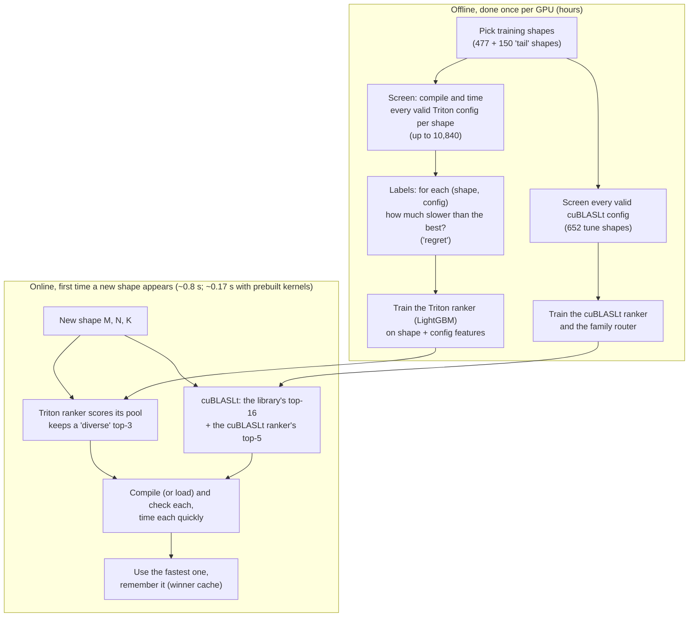
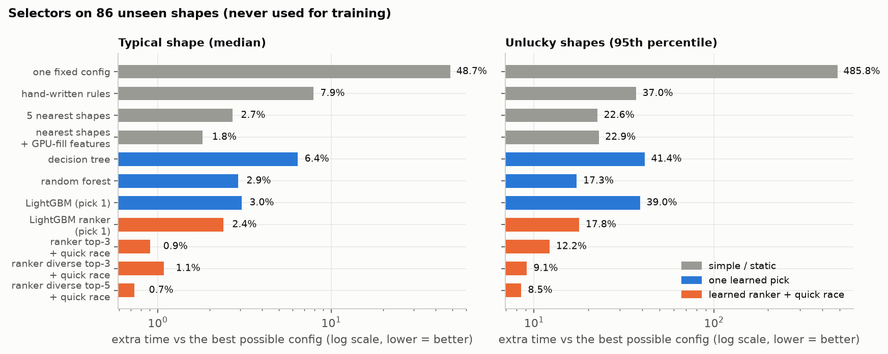
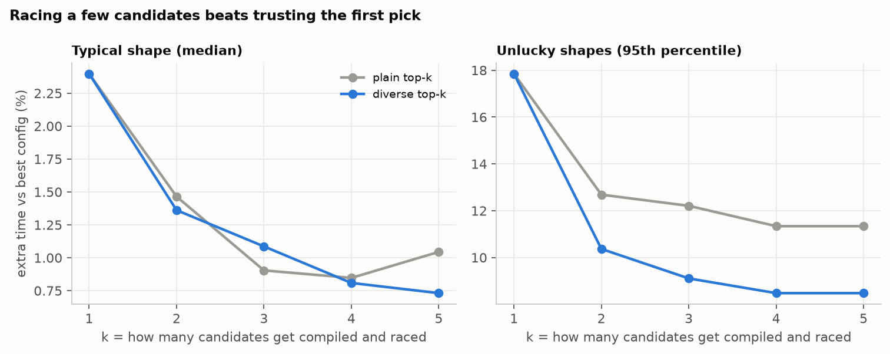
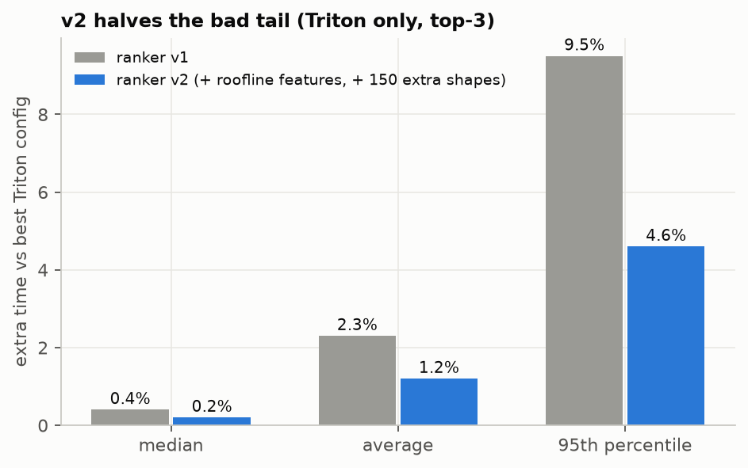
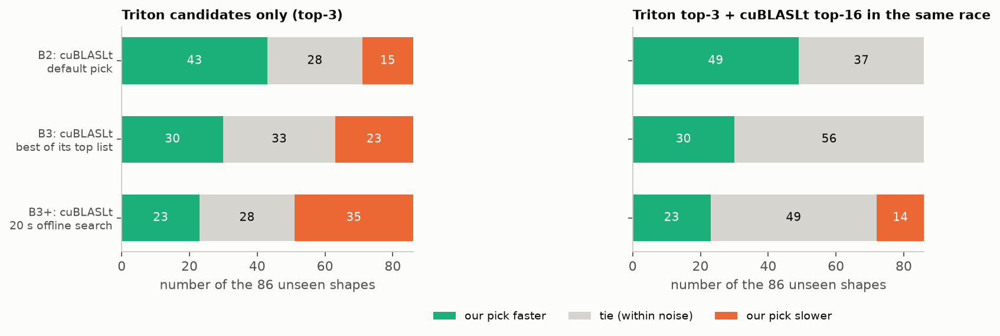
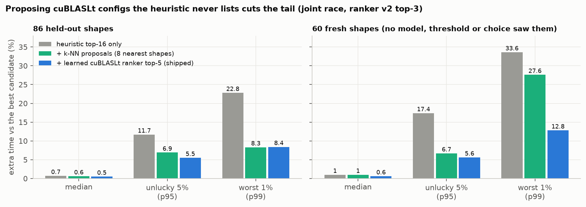
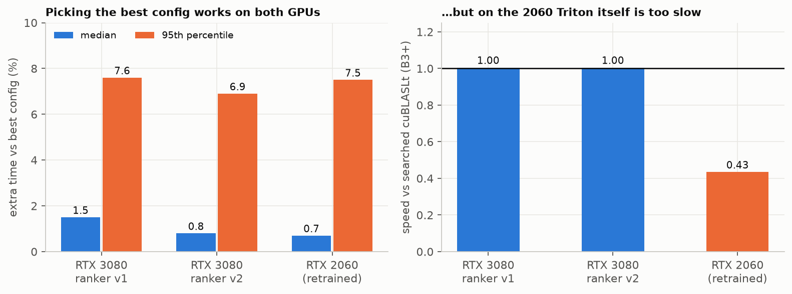

# 3. Model training and results

## 3.1 The idea in one picture

We cannot try every config for every new shape (too slow). So we **learn from shapes we already measured**, guess a short list for a new shape, and **race** only that list.

**Regret** (used everywhere below): `regret = (time of the chosen config) / (time of the best config) − 1`. So 0% is perfect and 50% means "50% slower than the best".

**Held-out test.** The selector never sees 86 shapes during training. Every number below is on those 86 (see [shapes](04_shapes.md)).

## 3.2 What we trained

| Group | Models | Idea |
|---|---|---|
| Simple rules | best single config (B6), a hand-written rule | no learning |
| Nearest neighbours | 1-NN / 5-NN on (M, N, K), plus "GPU-fill" features (how many tiles, how full the last wave is), plus per-candidate features | "use what worked for the most similar shape" |
| Learned, one pick | decision tree, linear SVM, logistic regression, random forest, LightGBM, each as a **classifier** (predict the winner) or a **ranker** (predict how slow each config is) | standard ML, tuned with cross-validation that never lets two similar shapes sit on both sides of the split |
| **Ranker + race (our bar)** | LightGBM regression of log-regret per (shape, config). Keep top-k, **diverse** picks (different tile groups), compile and quickly time them | the model only needs to put the winner *near the top*, not exactly first |
| Ranker v2 | v1 plus 8 "physics-like" features (estimated time from a roofline, bytes per operation, split-K traffic, tiles per SM), extra weight on near-best rows, and 150 extra training shapes aimed at weak spots | fix the tail |

## 3.3 Results on the 86 unseen shapes

*Left: the typical shape. Right: the unlucky 5%. Log scale, shorter is better.*

| Selector | Median | Mean | Unlucky 5% | Worst 1% |
|---|---|---|---|---|
| One fixed config (B6) | +48.7% | +111% | +486% | +948% |
| Hand-written rule | +7.9% | +13.2% | +37% | +68% |
| 5 nearest shapes (M, N, K) | +2.7% | +9.5% | +23% | +122% |
| Nearest shapes + GPU-fill features | +1.8% | +6.5% | +23% | +41% |
| Best single learned pick (random forest, rank) | +2.9% | +5.1% | +17% | +34% |
| LightGBM ranker, pick 1 | +2.4% | +4.1% | +18% | +24% |
| Ranker, **diverse top-3** + race | **+1.1%** | **+2.6%** | **+9.1%** | **+20%** |
| Ranker, diverse top-5 + race | +0.7% | +2.4% | +8.5% | +20% |

*"Worst 1%" is the 99th percentile: with 86 shapes, the single worst shape or the worst two.*

What we learned:

1. **Per shape beats one fixed config** by a very large margin.
2. **Simple nearest-neighbour methods with GPU-aware features are strong**: better than most "fancier" learned classifiers. Classifier and linear models were worse than k-NN.
3. **Racing a short list is the biggest single win.** Going from pick-1 to a diverse top-3 cut the unlucky-5% from 18% to 9%. The worst 1% moves much less (24% to 20%): a few odd shapes (such as 320×1×79 and 5398×196×774) are still 20% off, and racing three candidates does not rescue a shape the ranker has no good candidate for.

*k = how many candidates are compiled and raced. "Diverse" keeps the top pick, then adds the best config from each new tile group, so the three are not near-copies. It helps most in the unlucky tail. Each extra candidate costs about 0.15 s on first use (mostly compile time).*

Cost: the diverse top-3 takes about **0.4 s** the first time a shape is seen (median). After that, the answer is reused.

## 3.4 Ranker v2: fixing the tail

*Triton-only, top-3, 86 unseen shapes. The unlucky-5% regret halves (9.5% to 4.6%), the worst 1% falls from 15.1% to 9.6%, and the mean falls from 2.3% to 1.2%. The paired speed test says this is a real effect.* v2 needs no measurement of the GPU's peak speed, because the gain comes from the tile geometry features. The price is about 0.08 s more per first use.

## 3.5 Joining Triton and cuBLASLt in one race

Triton alone cannot beat NVIDIA's best (see [baselines](02_baselines.md)). So we also put cuBLASLt's top-16 suggestions into the **same race** (no compile needed, so only +0.08 s).

*Counts of the 86 unseen shapes where our pick is faster / tied / slower than each cuBLASLt reference (ranker v2). Left: Triton only. Right: Triton top-3 plus cuBLASLt top-16.*

- Versus NVIDIA's default pick (B2): **faster on 49 shapes, slower on 0**. Median speed is 0.90× the time of B2 (about 10% faster). "Never slower" is partly by construction: B2's own pick is in the race, so the race can lose to it only by timing noise.
- Versus the best of NVIDIA's list (B3): faster on 30, slower on 0 (B3's candidates are in the race too).
- Versus the 20-second offline search (B3+): level on the median, **slower on 14 shapes**. The offline search finds cuBLASLt configs the library's list never shows: on 20 of the 86 shapes the overall best kernel is one of them.
- Final default: **k = 3** Triton candidates, **k = 5** for kernels called very often (over 1 million calls), where the extra 0.3 s is repaid by the many calls.

## 3.6 Closing the gap to the offline search: proposing cuBLASLt configs

The 14 shapes where B3+ wins need cuBLASLt configs that the heuristic top-16 does not contain. Two ways to propose a few of them online, both validated and raced like every other candidate:

| Proposal source | How it works | Trained on |
|---|---|---|
| **k-NN** | the 2 best deep-search configs of each of the 8 most similar training shapes | the tune shapes' 20-second searches; k = 8 chosen by leave-one-out on tune shapes only |
| **Learned cuBLASLt ranker** (shipped) | a LightGBM model scores *every* valid cuBLASLt config for the shape (≈0.1–0.2 s) and proposes the top 5 | a full screen of all cuBLASLt configs on 652 tune shapes (1.29 M timings) |

*Regret against the best candidate any pool could have found (including the proposals' own timings). Left: the 86 held-out shapes. Right: 60 fresh shapes (3.8).*

| Pool (v2 top-3 + cuBLASLt top-16 + …) | median | unlucky 5% | worst 1% | mean | shapes > 5% off | slower than B3+ | first use |
|---|---|---|---|---|---|---|---|
| nothing more | 0.7% | 11.7% | 22.8% | 2.8% | 14 | 17 | 0.66 s |
| + k-NN proposals | 0.6% | 6.9% | 8.3% | 1.7% | 9 | 13 | 0.77 s |
| **+ learned ranker top-5 (shipped)** | **0.5%** | **5.5%** | **8.4%** | **1.4%** | **5** | **7** | 0.80 s |

*Same stage-2 session for all rows. The "slower than B3+" count of the first row (17) differs from the 14 of 3.5 because 3.5 comes from another session; such differences are timing noise.*

- **The learned ranker beats the heuristic-only race**, and a paired bootstrap confirms it: mean regret −1.44 points [−2.44, −0.65], worst 1% −12.8 points [−20.0, −4.5].
- **The ranker is not shown better than k-NN on these 86 shapes** (mean −0.35 points [−0.82, +0.09]). It was chosen because it closes more of the gap in tune cross-validation (78% vs 71% at 10 candidates) and leaves fewer shapes > 5% off (5 vs 9). k-NN remains the fallback when no ranker exists for the GPU.
- **Against B3+**: the shipped pool ties at ≥ 50 µs (geometric mean 1.001, 4 faster / 6 slower of 30) and is faster below 50 µs (0.951, 19 faster / 1 slower of 56). So gate G4 (beat B3+ where it matters) still fails; the win is on tiny GEMMs, which are graph-timed and have no cross-session noise study yet.
- An earlier version of this table scored against an oracle that could not see the proposals' own timings, which gave some proposals negative regret and read 0.4 / 4.7 / 1.2%. The audit (`reports/week1.md` 2026-11-04 audit) corrected it to the numbers above.

## 3.7 The family router, and why the order of timing matters

Without prebuilt kernels the Triton half costs about 0.6 s of the 0.8 s, and on 40 of 86 shapes the race ends on a cuBLASLt kernel anyway. The **router** is a small LightGBM classifier that, *after* the cuBLASLt candidates are timed, predicts whether any Triton candidate can still win by more than the tie margin, and skips compiling the Triton half when that probability is under 0.02 (tune out-of-fold AUC 0.82; threshold fixed by a rule before any held-out run).

Building it exposed a measurement effect: **the order in which near-tied candidates are timed changes which one wins.** Timing cuBLASLt first, with nothing skipped, was worse than Triton first on 5 shapes and better on 1, while three identical-order runs never disagreed. The fix is a confirmation pass: re-time the 3 fastest candidates in reverse order and rank by the mean of both timings.

| Run (86 held-out shapes) | median | unlucky 5% | worst 1% | mean | > 5% off | slower than B3+ | first use (no bundle) |
|---|---|---|---|---|---|---|---|
| Triton first, no router | 0.5% | 5.5% | 8.4% | 1.4% | 5 | 7 | 0.80 s |
| cuBLASLt first, no skipping, no confirmation | 0.6% | 7.3% | 9.3% | 1.7% | 8 | 9 | — |
| **Router + confirmation (shipped when kernels must compile)** | **0.4%** | **4.9%** | **8.8%** | **1.3%** | **4** | **5** | **0.71 s** |

The router skips 14 of 86 shapes, none of which is worse than with the full race. It saves cost and does not improve the worst case. With the prebuilt kernels of [chapter 6](06_shipping.md) the Triton half costs only about 0.06 s, so `select_kernel` turns the router on only when the kernels really compile. Folding both families into one learned score (instead of a fixed pool) was tried and is worse (unlucky 5% 9.1% vs 5.5% at 10 candidates); it is not shipped.

## 3.8 Fresh shapes: does the shipped selector hold on shapes nobody looked at?

Every choice in 3.6 and 3.7 was compared on the same 86 held-out shapes. To rule out tuning to that set, 60 **fresh** shapes were generated afterwards (seed 465, `suites/fresh.py`). They are 30 random shapes and 30 linear-layer sizes of LLMs not in S2 (Qwen2-7B, Gemma-2-9B, Phi-3-mini, Mistral-Nemo-12B, Yi-6B). None is in any suite, none shares two of M, N, K with a training shape, and a test asserts this. Everything was frozen: no refit, no new threshold.

| Pool (60 fresh shapes) | median | unlucky 5% | worst 1% | mean | > 5% off | slower than B3+ |
|---|---|---|---|---|---|---|
| heuristic top-16 only | 1.0% | 17.4% | 33.6% | 3.3% | 9 | 14 |
| + k-NN proposals | 1.0% | 6.7% | 27.6% | 2.5% | 7 | 13 |
| **+ learned ranker top-5 (shipped)** | **0.6%** | **5.6%** | **12.8%** | **1.6%** | **4** | **10** |

- The ordering heuristic < k-NN < learned ranker **replicates**. Versus the heuristic-only race the paired time ratio is 0.985 [0.969, 0.997] (5 faster, 0 slower).
- Against NVIDIA: **faster than B2 on 42 of 60 shapes and slower on 1** (median 0.924); level with B3+ at the median (1.000, 11 faster / 10 slower).
- The router replicates too: 15 of 60 shapes skipped, quality unchanged (0.5 / 5.2 / 12.9 / 1.6%), first use −10%. None of the 15 is a shape where Triton truly wins (router AUC 0.861 on these shapes vs 0.823 in tune cross-validation).
- The tail is a little heavier than on held-out. The worst shape (96×5120×14336, 17.9% off) is one where the best Triton config is 16% faster than B3+ and the Triton ranker's top-3 did not contain a config close to it.

## 3.9 Does it work on another GPU?

We repeated the whole recipe on an **RTX 2060** (retrained from scratch on 56 shapes, tested on 27 unseen shapes that are also in the 3080's test set).

- **Selection quality is similar** on both GPUs (typical shape 0.7–1.5% off the best, unlucky 5% about 7–8% off, worst 1% 9–10% on the 3080 and 13% on the 2060). With only 27 shapes we can say "no clear difference", not "equal".
- **But the Triton kernels are far slower than cuBLASLt on the 2060** (median 0.44× of B3+, and 0.24× on jobs of 50 µs or more). The compiled Triton code had no tensor-core instructions on this GPU/compiler version. Whether another Triton version or setting produces them was not tested.
- Reading: **the selector transfers, the kernel family may not.** [Chapter 5](05_transferability.md) adds the zero-shot test (the 3080's trained model used unchanged) and an RTX 3090: zero-shot fails on the 2060 and works on the 3090.

## 3.10 Limits

- One main GPU, one driver, 86 held-out + 60 fresh test shapes. The 95th percentile is set by the 4–5 worst shapes, and the 99th by one or two.
- The offline B3+ search still beats the shipped online pick on 7 of 86 held-out shapes (10 of 60 fresh). The remaining misses are ranker mistakes on odd shapes (N = 1, tiny K, a few large LLM layers).
- We never reach "faster than the best cuBLASLt at big sizes" (G4 fails at ≥ 50 µs). The value is **never worse than NVIDIA's default beyond noise, about 8–10% faster than it on a typical shape, in under a second of first use.**
- The 150 tail shapes were chosen after seeing where training errors were, and while analysing we had also seen held-out shapes with N ≈ 1. No held-out shape was used in any fit, but that regime was not picked in perfect isolation (noted in `reports/week1.md`). Likewise, shipping the cuBLASLt ranker's top-5 rather than its top-10 was decided after the held-out table showed them equal; the fresh shapes (3.8) were generated afterwards to check such choices.

---
Previous: [2. Baselines](02_baselines.md) · Next: [4. Shapes](04_shapes.md) · Later: [5. Transferability](05_transferability.md), [6. Shipping](06_shipping.md), [7. Deployment](07_deployment.md)
