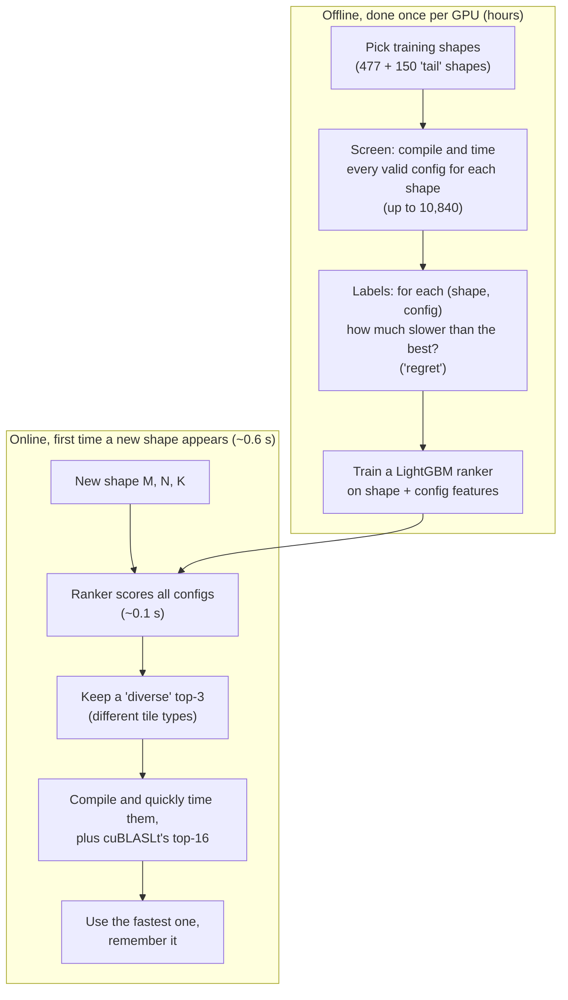
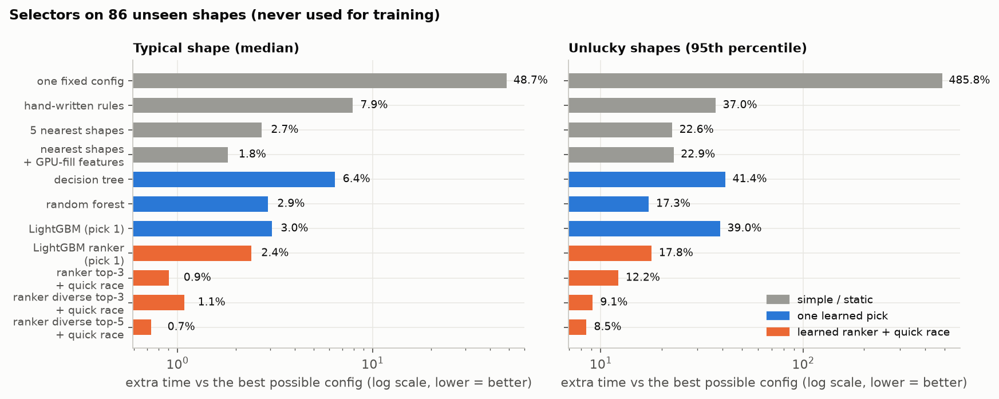
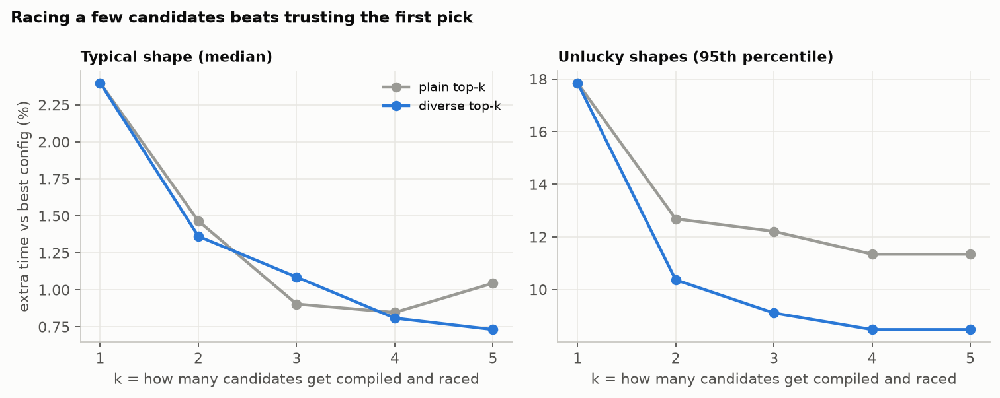
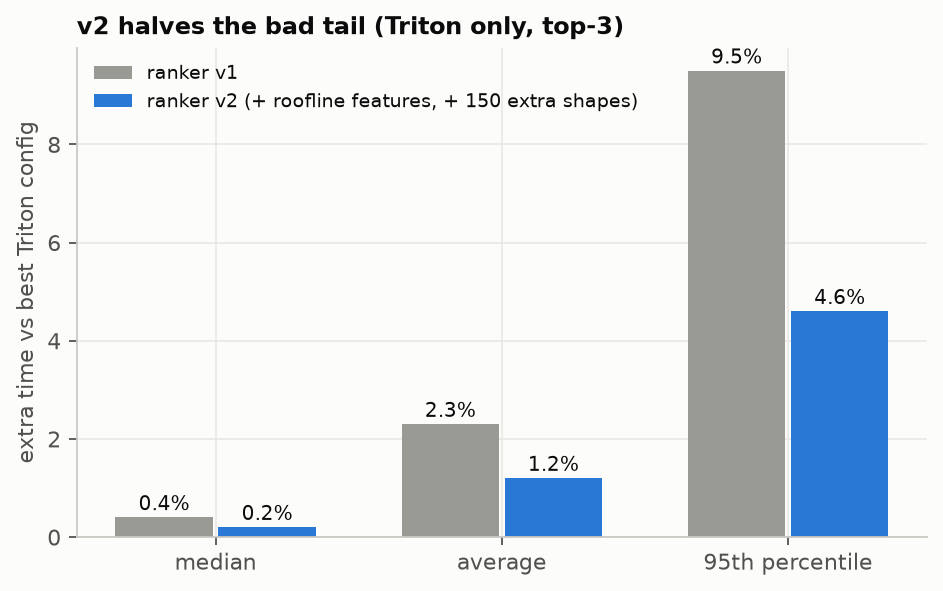
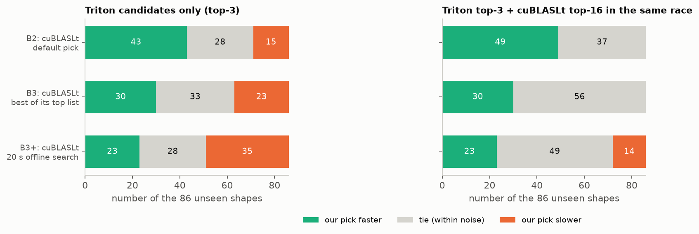
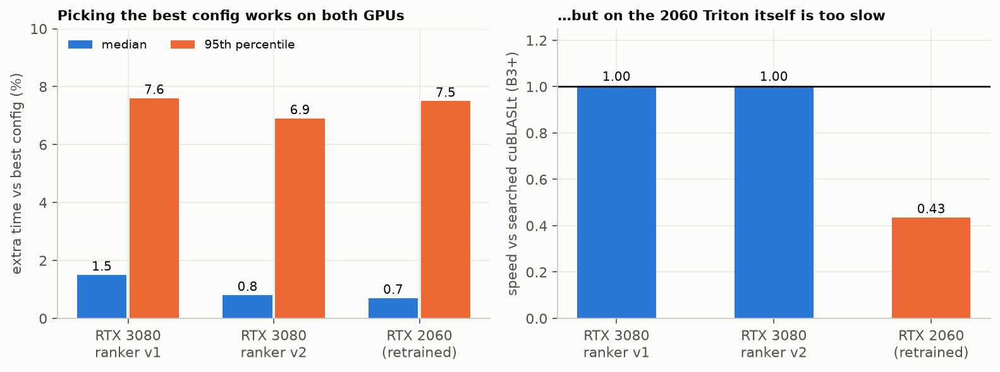

# 3. Model training and results

## 3.1 The idea in one picture

We cannot try every config for every new shape (too slow). So we **learn from shapes we already measured**, guess a short list for a new shape, and **race** only that list.

**Regret** (used everywhere below): `regret = (time of the chosen config) / (time of the best config) − 1`. So 0% is perfect and 50% means "50% slower than the best".

**Held-out test.** The selector never sees 86 shapes during training. Every number below is on those 86 (see [shapes](04_shapes.md)).

## 3.2 What we trained

| Group | Models | Idea |
|---|---|---|
| Simple rules | best single config (B6), a hand-written rule | no learning |
| Nearest neighbours | 1-NN / 5-NN on (M, N, K), plus "GPU-fill" features (how many tiles, how full the last wave is), plus per-candidate features | "use what worked for the most similar shape" |
| Learned, one pick | decision tree, linear SVM, logistic regression, random forest, LightGBM, each as a **classifier** (predict the winner) or a **ranker** (predict how slow each config is) | standard ML, tuned with cross-validation that never lets two similar shapes sit on both sides of the split |
| **Ranker + race (our bar)** | LightGBM regression of log-regret per (shape, config). Keep top-k, **diverse** picks (different tile groups), compile and quickly time them | the model only needs to put the winner *near the top*, not exactly first |
| Ranker v2 | v1 plus 8 "physics-like" features (estimated time from a roofline, bytes per operation, split-K traffic, tiles per SM), extra weight on near-best rows, and 150 extra training shapes aimed at weak spots | fix the tail |

## 3.3 Results on the 86 unseen shapes

*Left: the typical shape. Right: the unlucky 5%. Log scale, shorter is better.*

| Selector | Median | Mean | Unlucky 5% | Worst 1% |
|---|---|---|---|---|
| One fixed config (B6) | +48.7% | +111% | +486% | +948% |
| Hand-written rule | +7.9% | +13.2% | +37% | +68% |
| 5 nearest shapes (M, N, K) | +2.7% | +9.5% | +23% | +122% |
| Nearest shapes + GPU-fill features | +1.8% | +6.5% | +23% | +41% |
| Best single learned pick (random forest, rank) | +2.9% | +5.1% | +17% | +34% |
| LightGBM ranker, pick 1 | +2.4% | +4.1% | +18% | +24% |
| Ranker, **diverse top-3** + race | **+1.1%** | **+2.6%** | **+9.1%** | **+20%** |
| Ranker, diverse top-5 + race | +0.7% | +2.4% | +8.5% | +20% |

*"Worst 1%" is the 99th percentile: with 86 shapes, the single worst shape or the worst two.*

What we learned:

1. **Per shape beats one fixed config** by a very large margin.
2. **Simple nearest-neighbour methods with GPU-aware features are strong**: better than most "fancier" learned classifiers. Classifier and linear models were worse than k-NN.
3. **Racing a short list is the biggest single win.** Going from pick-1 to a diverse top-3 cut the unlucky-5% from 18% to 9%. The worst 1% moves much less (24% to 20%): a few odd shapes (such as 320×1×79 and 5398×196×774) are still 20% off, and racing three candidates does not rescue a shape the ranker has no good candidate for.

*k = how many candidates are compiled and raced. "Diverse" keeps the top pick, then adds the best config from each new tile group, so the three are not near-copies. It helps most in the unlucky tail. Each extra candidate costs about 0.15 s on first use (mostly compile time).*

Cost: the diverse top-3 takes about **0.4 s** the first time a shape is seen (median). After that, the answer is reused.

## 3.4 Ranker v2: fixing the tail

*Triton-only, top-3, 86 unseen shapes. The unlucky-5% regret halves (9.5% to 4.6%), the worst 1% falls from 15.1% to 9.6%, and the mean falls from 2.3% to 1.2%. The paired speed test says this is a real effect.* v2 needs no measurement of the GPU's peak speed, because the gain comes from the tile geometry features. The price is about 0.08 s more per first use.

## 3.5 Joining Triton and cuBLASLt in one race

Triton alone cannot beat NVIDIA's best (see [baselines](02_baselines.md)). So we also put cuBLASLt's top-16 suggestions into the **same race** (no compile needed, so only +0.08 s).

*Counts of the 86 unseen shapes where our pick is faster / tied / slower than each cuBLASLt reference (ranker v2). Left: Triton only. Right: Triton top-3 plus cuBLASLt top-16.*

- Versus NVIDIA's default pick (B2): **faster on 49 shapes, slower on 0**. Median speed is 0.90× the time of B2 (about 10% faster).
- Versus the best of NVIDIA's list (B3): faster on 30, slower on 0.
- Versus the 20-second offline search (B3+): level on the median, **slower on 14 shapes** (the part that needs the offline search). B3+ stays out of reach for a 0.7 s online selector.
- Final default: **k = 3** candidates, **k = 5** for kernels called very often (over 1 million calls), where the extra 0.3 s is repaid by the many calls.

## 3.6 Does it work on another GPU?

We repeated the whole recipe on an **RTX 2060** (retrained from scratch on 56 shapes, tested on 27 unseen shapes that are also in the 3080's test set).

- **Selection quality is similar** on both GPUs (typical shape 0.7–1.5% off the best, unlucky 5% about 7–8% off, worst 1% 9–10% on the 3080 and 13% on the 2060). With only 27 shapes we can say "no clear difference", not "equal".
- **But the Triton kernels are far slower than cuBLASLt on the 2060** (median 0.43× of B3+, and 0.24× on jobs of 50 µs or more). The compiled Triton code had no tensor-core instructions on this GPU/compiler version. We did not test whether a different setting fixes this.
- Reading: **the selector transfers, the kernel family may not.** The zero-shot test (the 3080's trained model used unchanged) has since been run on the 2060 and on an RTX 3090; the answer is in [chapter 5](05_transferability.md): it fails on the 2060 and works on the 3090.

## 3.7 Honest limits

- One main GPU, one driver, 86 test shapes. The 95th percentile is set by only the 4–5 worst shapes, and the 99th by one or two.
- The offline B3+ search still beats our online pick on 14 shapes. Remaining misses are ranker mistakes on odd shapes such as N = 1 or tiny K.
- We never reach "faster than the best cuBLASLt at big sizes". The value is **never worse than NVIDIA's defaults, and 10% faster than its default on a typical shape, in under a second.**
- The 150 tail shapes were chosen after seeing where training errors were, and while analysing we had also seen held-out shapes with N ≈ 1. No held-out shape was used in any fit, but that regime was not picked in perfect isolation (noted in `reports/week1.md`).

---
Previous: [2. Baselines](02_baselines.md) · Next: [4. Shapes](04_shapes.md) · Later: [5. Transferability](05_transferability.md), [6. Shipping](06_shipping.md)
