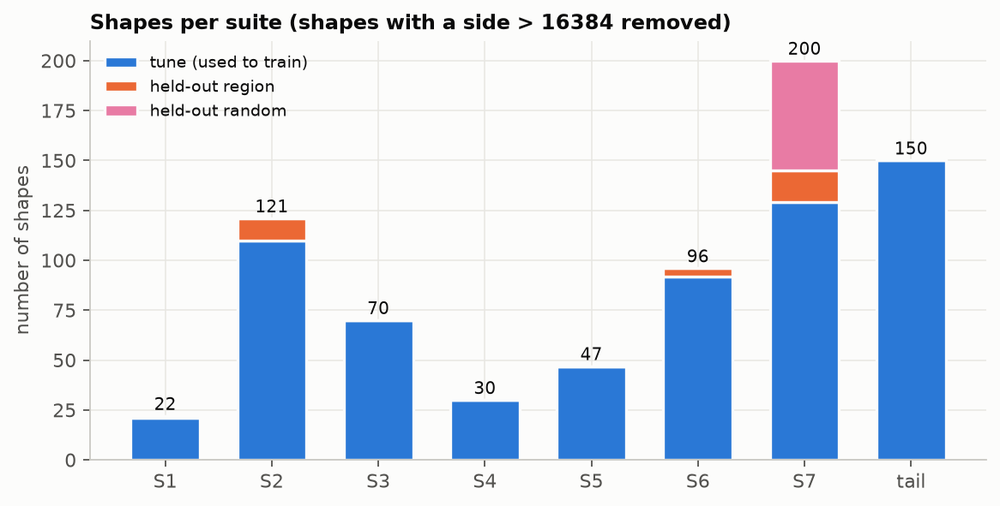
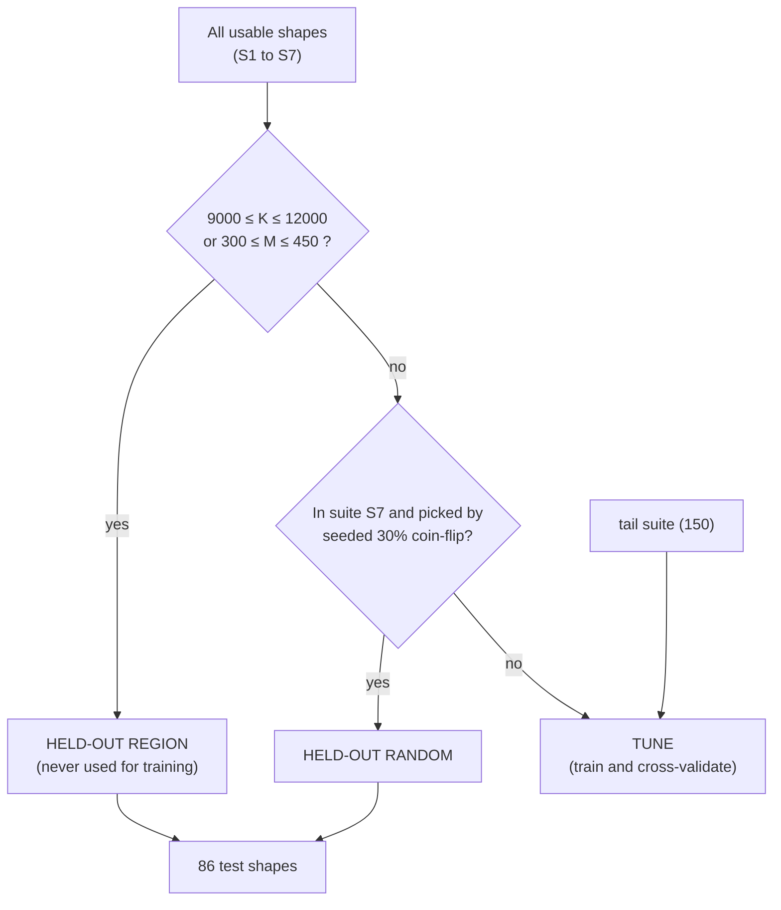
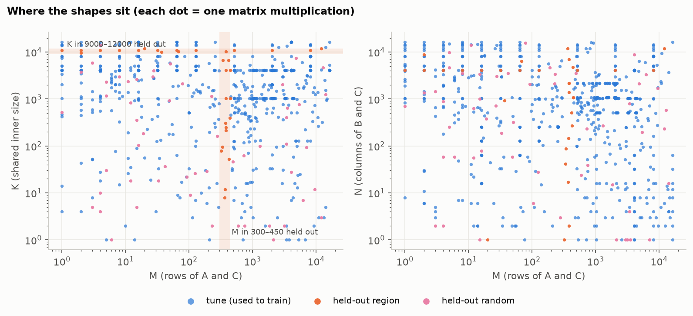

# 4. Which shapes did we choose, and why?

A selector is only as good as the shapes it saw. We built the shape lists **before any results existed**, with a fixed random seed (464), so we could not tune the tests to our answers. The code is `suites/generate.py`.

## 4.1 The suites

| Suite | What it contains | Why it is there |
|---|---|---|
| **S1 square** | n×n×n, powers of two (64 to 16384) plus awkward sizes (1000, 2047, 4097, 12000 …) | the classic benchmark. Shows the hardware limit, and what odd sizes cost |
| **S2 LLM layers** | real layer sizes from LLaMA-2 (7B, 13B, 70B) and LLaMA-3 8B, with 1 to 8192 tokens (M = 1 is one word at a time, M = 8192 is a long prompt) | the shapes that matter in practice. Decode (small M) is memory-bound; prefill (large M) is compute-bound |
| **S3 skinny/tall** | one very small side (1 to 64) with two large sides, in both orientations | small M is "decode"; small N tests the opposite case. Hard for tile-based kernels |
| **S4 large K** | small M and N, K = 4096 to 16384 | few tiles, a very long inner sum. Tests split-K |
| **S5 unaligned** | primes and odd sizes (7, 127, 1021, 8191 …) plus an "alignment ladder" (4096, 4095, 4094 …) | GPUs load memory fastest in 16-byte pieces. Odd sizes break that |
| **S6 wave boundary** | built from the GPU's SM count: tile counts one below, at, and one above a full wave (68, 136, …) | tests the "69 tiles on 68 SMs" cliff directly |
| **S7 random** | 200 shapes with M, N, K drawn log-uniformly from 1 to 16384 | no human bias. Covers the middle ground |
| **tail** (added later) | 150 extra shapes: narrow-N (30), small-M (30), tiny-K (20), unaligned and under 50 µs (40), mid-size (20), small split-K (10) | extra *training* data in the regimes where the first model was weakest |
| edge | 169 degenerate shapes (1×1×1, K smaller than a tile …) | **correctness only**: every kernel must give the right answer first |
| noise | 30 shapes spread over the suites and over run time | used for the noise study only |

Limits (the project's frozen scope): sizes up to 16384, fp16, plain `C = A × B`. LLaMA-70B's 28672-wide layers are kept in the file but tagged "out of range" (22 shapes) and not used.

*Total after removing out-of-range shapes. A shape that appears in two suites is counted in both here, but counted once when training (477 unique training shapes and 86 unique test shapes were actually screened; 4 very large shapes were not screened, probably for memory reasons, which was not checked).*

## 4.2 The train / test split, and why it is built this way

If you test on shapes that sit right next to training shapes, the score looks great but proves little, because real users bring new sizes. So we hid whole **regions**, not only random points:

| Part | Rule | Why |
|---|---|---|
| **Held-out region** | any shape with K from 9000 to 12000 (contains LLaMA-7B's 11008 width) or M from 300 to 450 | tests whether the model **extrapolates** into sizes it never saw |
| **Held-out random** | 30% of S7, chosen by seeded random choice | tests **ordinary unseen points** |
| **Tune** | everything else, plus the tail suite | learn here. Hyper-parameters are chosen by grouped cross-validation |

*Each dot is a shape (log axes). Orange is held-out region (the bands), pink is held-out random, blue is tune. The grid-like rows are the LLM layer sizes.*

Counts: **477** tune shapes (+150 tail for ranker v2), **86** held-out shapes (30 take ≥ 50 µs, 56 take less), and 27 of those 86 were also used on the RTX 2060 and the RTX 3090 (the shared set of [chapter 5](05_transferability.md)).

## 4.3 Why we trust the test

- **Held-out shapes are never used in fitting.** That means not for the menu of configs, nor for k-NN weights, nor for the rule, nor for the model. The one place held-out shapes could have influenced a choice (narrow-N in the tail suite) is stated openly in [3.7](03_model_training.md).
- The tail suite excludes any shape that shares two of (M, N, K) with a held-out shape.
- Results are always reported as **median, mean, and the worst 5%**, and separately for jobs that are short (< 50 µs) or long, because the average hides the tail.

---
Previous: [3. Model training](03_model_training.md) · Next: [5. Transferability](05_transferability.md) · Back to [README](README.md)
