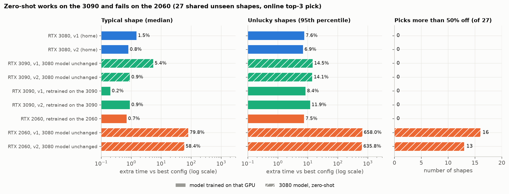
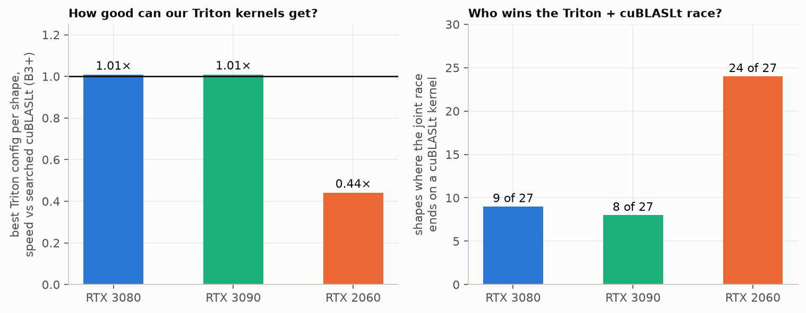
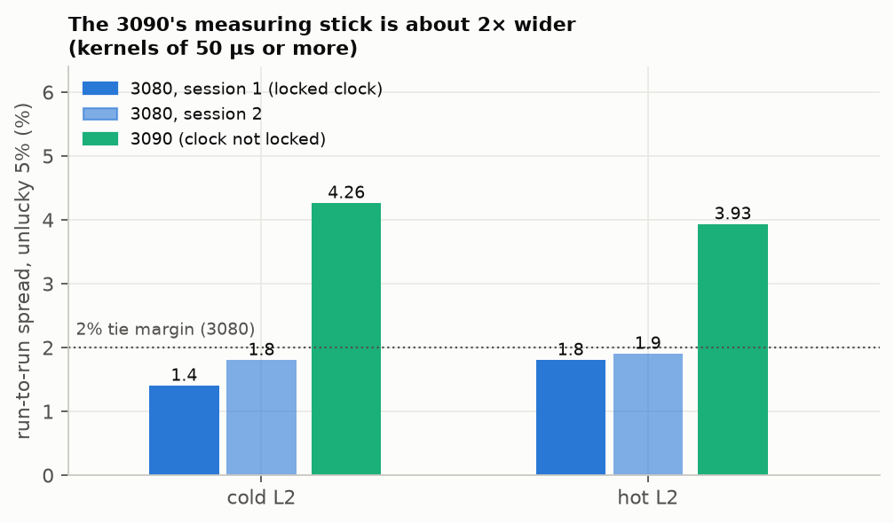

# 5. Does it work on another GPU? (transferability and zero-shot)

Everything in chapters 2–4 was measured on one card, the RTX 3080. A selector is only useful if it can be moved to other GPUs, so we ran two kinds of test on two more cards.

| Test | Question | What we do |
|---|---|---|
| **Retrain** ("transfer the recipe") | If we repeat the whole pipeline on a new GPU, do we get a selector that is as good? | Measure the new GPU, train its own models, score them on unseen shapes |
| **Zero-shot** ("transfer the model") | If we copy the 3080's trained models to the new GPU and change nothing, do they still pick well? | Run the 3080's saved models on the new GPU, score the picks against that GPU's own best |

| GPU | Chip generation | Tensor cores usable by our Triton kernels? | Retrain | Zero-shot |
|---|---|---|---|---|
| RTX 3080 (home) | Ampere (sm_86), 68 SMs, 10 GB | yes | – (the main study) | – |
| **RTX 3090** | Ampere (sm_86), 82 SMs, 24 GB | yes | full run, 2026-11-09 | 2026-11-03 |
| **RTX 2060** | Turing (sm_75), 30 SMs, 6 GB | **no** (see 5.3) | 56 shapes, 2026-11-02 | 2026-11-02 and 2026-11-08 |

**How we score.** All numbers below are on the **27 unseen shapes** that the three GPUs share (a subset of the 86 test shapes of chapter 3). Each pick is compared with the best config *that GPU* could have used (its own screen), so "regret 5%" means "5% slower than the best on that card". The 27 shapes are few, so the 95th percentile ("unlucky 5%") is set by the worst one or two shapes: read the medians and the counts first.

## 5.1 The main picture

*Online top-3 pick, 27 shared unseen shapes. Solid bars: the model was trained on that GPU. Hatched bars: the 3080's model used unchanged (zero-shot). Log scale, shorter is better. On the 2060 the "more than 50% off" count is 16 of 26 scored (v1) and 13 of 26 (v2); one shape of each had no score. The 3090's v1 and v2 are the 3080's two rankers (v2 has the roofline features, see chapter 3).*

| Online top-3 (27 shapes) | median | unlucky 5% | worst 1%* | picks > 50% off |
|---|---|---|---|---|
| 3080, own v1 / v2 | 1.5% / 0.8% | 7.6% / 6.9% | 9.2% / 10.2% | 0 / 0 |
| **3090 zero-shot**, v1 / v2 | 5.4% / **0.9%** | 14.5% / 14.1% | 26.5% / 14.4% | **0 / 0** |
| 3090 retrained, v1 / v2 | 0.2% / 0.9% | 8.4% / 11.9% | 16.2% / 15.2% | 0 / 0 |
| 2060 retrained | 0.7% | 7.5% | 13.3% | 0 |
| **2060 zero-shot**, v1 / v2 | 80% / 58% | 658% / 636% | 3099% / 3256% | **16 / 13** (+1 unscored each) |

\*With 27 shapes the worst 1% is the single worst shape.

## 5.2 RTX 3090: same chip family, the models carry over

- **Zero-shot works.** Not one of the 27 picks is more than 50% off, for either model. The v2 model is statistically the same as the 3080's own (mean difference +1.4 points, interval −0.7 to +3.6). The v1 model is measurably worse (+3.5 points [+1.1, +6.4], 14 of 27 shapes more than 5% off). So **the model with the physics-style features (v2) is the one that generalises**; v1 leans on details of the 3080.
- **Retraining on the 3090 fixes v1** (difference vs the 3080 falls to −0.4 [−1.9, +1.4]) and adds little for v2 (zero-shot +1.4 → retrained +0.1; shapes over 5% off: 10 → 6; the 3090's own measuring noise is 4–5%, see 5.4). In plain words: a retrain mostly repairs the model that over-fitted the 3080.
- **The full retrain** ran on a cluster node (everything fitted from 3090 data, nothing borrowed): 477 + 150 tail shapes screened, rank v1 and v2, the cuBLASLt ranker and the router refit. On all 86 unseen shapes, Triton-only online top-3 with v2: **2.1% typical, 13.6% unlucky 5%, 20% worst 1%** (for comparison, the 3080's v1 on the same 86 shapes: 1.1% / 9.1% / 20%; v1 on the 3090 had a worse tail, 43% worst 1%). No pick is more than 50% off.
- **The joint race (Triton top-3 + cuBLASLt top-16) behaves as on the 3080:** faster than NVIDIA's default (B2) on **61 of 86 shapes and slower on 0** (3080: 49 / 0), level with the 20-second offline search at the median (0.994×, faster on 26, slower on 9), first use about 0.9 s. The final pick is a cuBLASLt kernel on 24% of shapes here, versus 41% on the 3080: the vendor's heuristic is better on the 3080, so the value of the Triton half is GPU-specific.

## 5.3 RTX 2060: the models fail, but the recipe and the safety net work

*Left: the best Triton config per shape, as speed relative to the searched cuBLASLt (1.0 = tie). Right: in how many of 27 shapes the joint race ends on a cuBLASLt kernel (3080 v2, 3090 zero-shot v2, 2060 zero-shot v2).*

- **Retrained on the 2060, the selector is as good as on the 3080** (0.7% typical, 7.5% unlucky 5%; no pick more than 50% off; the paired test against the 3080 is a tie, −0.1 points [−1.7, +1.6]). The *recipe* transfers. It cost about 10 hours of screening on 56 shapes.
- **Zero-shot fails:** 13 to 16 of 27 picks are more than 50% off. Letting the model see the 2060's own limits ("native" variant) halves the damage but does not fix it (median 43%).
- **Why:** Triton's compiled code on this chip contains **no tensor-core instructions** (all 571 kernels in the run use plain multiply-add), so the best Triton config is only **0.44×** the speed of cuBLASLt (3080 and 3090: 1.01×). The 2060's best tiles are all small (BLOCK_K = 16), whereas the 3080's models ask for tiles tuned for tensor cores. This is a **confound**: we cannot say whether the models would also fail on a tensor-core card of another generation, only that on the 2060 the kernel family is the problem. The 3090 result (same instructions as the 3080, models carry over) is the evidence that points at the instructions.
- **The joint race rescues it.** With cuBLASLt's top-16 in the same race the result lands on its own ceiling: the final pick is a cuBLASLt kernel on **24 of 27** shapes in all four zero-shot variants, never slower than B2 beyond noise (faster on 7, slower on 0), about 1–2% slower than the offline search at the median. The ranker then makes no difference at 50 µs or more, and costs 10–20 s of first use for compiling slow kernels. On this card the practical selector is "time cuBLASLt's list and skip Triton".
- **A bug we found and fixed on the way.** The first zero-shot score dropped every pick that was more than 50% off (the screen stops timing a config after one slow sample), so the 2060 table looked several times better than it was (medians 6–16% instead of 43–80%). The scorer now keeps those rows and prints a "> 50% off" column. No earlier number changed: on the 3080 and the retrained 2060 every pick was a fully timed config.

## 5.4 The measuring stick is not the same on every GPU

*Run-to-run spread of the same timing over 3 rounds, unlucky 5% of kernels of 50 µs or more. The 3080 ran with its clock locked; the 3090 cluster job cannot lock the clock.*

On the 3080 two timings within **2%** count as a tie. On the 3090 the same noise study gives about **4–5%**, so on that card differences of a few percent between selectors are inside the noise of the oracle itself. The large effects stand (61 faster / 0 slower than B2; the v1 to v2 tail drop from 43% to 20%; 0 picks over 50% off). This is one session, so the real floor can only be larger. The reason for the extra noise is not identified (clock wander explains little).

## 5.5 What transfers and what does not

| Part of the selector | Moves to another GPU as it is? | Evidence |
|---|---|---|
| The design: rank, keep a diverse top-3, compile and race, joint pool with cuBLASLt | **Yes** | works on 3090 and 2060 without code changes |
| The Triton ranker v2 (roofline-style features) | **Yes within the same chip family** | 3090 zero-shot ≈ 3080 own (+1.4 [−0.7, +3.6]) |
| The Triton ranker v1 | Partly: usable but worse | 3090 +3.5 [+1.1, +6.4]; a retrain repairs it |
| Any Triton ranker across **tensor-core** vs **no tensor-core** chips | **No** | 2060: 13–16 of 27 picks > 50% off |
| The cuBLASLt ranker, the k-NN table, the router | **No, refit per GPU** (tile ids and SM counts differ; the code refuses a foreign GPU) | 3090 refit: weaker than on the 3080 (68% vs 78% of the gap closed at 10 candidates) |
| The winner cache | No (it is a per-machine file) | by design |
| The tie margin (what counts as a real difference) | **No, measure per GPU** | 2% on the 3080, about 5% on the 3090 |
| What NVIDIA's own library picks | No | cuBLASLt wins 41% of 3080 shapes, 24% of 3090, 89% of 2060 |

Whether the models cross to a different tensor-core generation (Ada, Hopper) is untested.

## 5.6 Honest limits

- 27 shared shapes: percentiles are the worst one or two shapes, and many differences between variants are inside their intervals.
- The 3090 numbers come from an **unlocked** clock and a different driver (590.48 vs 595.99); the 3080 and 2060 were locked at 1755 MHz. Compare regrets and ratios, never absolute times, across cards.
- On the 3090 we did **not** run the router's held-out score, a fresh-shape check, or the 3080's cuBLASLt ranker zero-shot. A log of the 3090's comparison script contains a `StopIteration` error whose cause was not investigated; the report was written afterwards and is complete, but 19–21 of the 27 joint picks have a stage-2 timing, so the joint comparison on those shapes is partly covered.
- The 2060 comparison is confounded by the missing tensor-core path (5.3).

---
Previous: [4. Shapes](04_shapes.md) · Next: [6. Shipping the selector](06_shipping.md)
