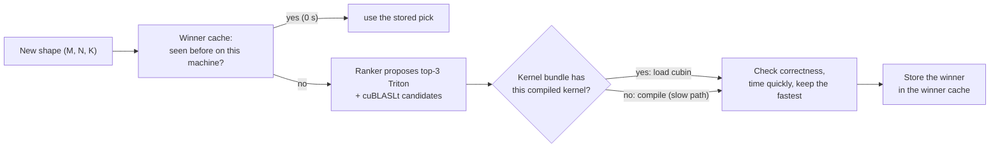
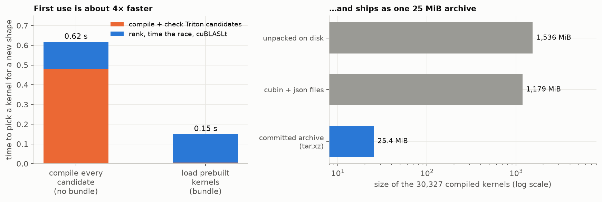

# 6. Shipping the selector: prebuilt kernels (cubin bundle) and the winner cache

A selector that takes a second to answer is fine for a program that runs for hours, but wasteful if every new matrix size pays a compile bill. This chapter is about how to make the first answer cheap on a machine that has never seen the shape.

## 6.1 The problem: compiling is most of the cost

To race its top-3 Triton candidates, the selector must first turn each candidate (a Python-level kernel plus its settings) into **GPU machine code**. That is Triton's **JIT compile**, about 0.13 s per kernel. Without any trick, compiling is **about two thirds** of the first-use time.

A **cubin** is the finished machine-code file for one kernel and one GPU architecture. If we compile every kernel the rankers could ever pick **once**, ahead of time, and ship the cubins, a new machine can *load* instead of *compile*.



## 6.2 What the bundle is

- **Contents.** Every kernel the v1 and v2 rankers of the 3080 *and* of the 3090 can propose, plus the 5 hand-picked configs: **1,690 configs**, each compiled for every way Triton can specialise its arguments (for example "this size is 1", "divisible by 16", "other"). That is **30,327 kernels** (30,315 matmul kernels and 12 split-K reduce kernels). The first build (the 3080's 1,176 configs, 21,187 kernels) took 688 s on 10 workers; the union rebuild of 2026-11-10 took 335 s because it reused that build's cache. The list of specialisations was checked on 202,525 random reachable shapes: none needs a kernel outside the set.
- **Why the obvious shortcut fails.** Triton's own cache cannot just be copied to another machine: its index files record absolute folder paths, so every entry would miss. A small custom cache manager (`kernels/bundle.py`) looks in this machine's cache, then in the read-only bundle, and **only then compiles**.
- **A miss costs time, never correctness.** If the bundle lacks a kernel, Triton compiles it as it always did. A bundle hit skips *compiling*, not *checking*: the correctness test still runs on every candidate.

## 6.3 What it buys



*Left: wall time to pick a kernel for a shape the process has never seen (10 unseen shapes, ranker v2, top-3 Triton + cuBLASLt top-16, empty Triton cache, one process per shape). Right: size of the compiled kernels.*

| Measurement | per new shape, without → **with** the bundle | Triton compile + check, without → **with** |
|---|---|---|
| 2026-11-04, 10 held-out shapes, first build | 0.618 s → **0.150 s** | 0.480 s → **0.005 s** |
| 2026-11-19 rerun, 30 held-out shapes, current bundle, clock locked | 0.619 s → **0.197 s** (median; means 0.703 → 0.228 s) | 0.463 s → **0.007 s** |

*Same search in both: ranker v2 top-3 + cuBLASLt top-16, no proposals, no router, empty Triton cache, one fresh process per run after a warm-up selection on another shape. The rerun's shapes are spread evenly over the held-out set by size, so its larger shapes spend more time in timing than the first set did; the compile saving is the same.*

**Does the bundle change which kernel wins?** The first measurement saw 9 of 10 shapes pick the same kernel with and without the bundle and did not explain the tenth (its per-shape data was not kept). The rerun (`results/bundle_ab.py`, session `20261119-022335-lock1755`) answers it with four runs per shape (bundle, no bundle, and a repeat of each) and finds no effect of the bundle:

| Comparison (30 shapes) | same pick | different pick |
|---|---|---|
| bundle vs no bundle | 29 | 1 |
| bundle vs no bundle (repeat) | 27 | 3 |
| bundle vs bundle (nothing changed) | 27 | 3 |
| no bundle vs no bundle (nothing changed) | 29 | 1 |

- **Picks flip as often between two identical runs as between bundle and no bundle**, and always on the same few shapes (4×4096×11008, 16×4096×11008, 33×190×18, 381×1401×250).
- **Every flip is a near-tie:** in the run that picked one, the other was at most 2.6% slower (median 0.2%). That is inside the short online timing's noise (about 3% at the 95th percentile with a locked clock, [2.4](02_baselines.md)), so the race picks between them arbitrarily.
- **The bundle runs the same binary:** all 386 kernels compiled fresh in the no-bundle runs are byte-identical to the bundle's file for the same Triton cache key. 206 bundle hits, 0 misses.
- So the tenth shape of the first measurement is explained by the class of cause, a near-tie decided by timing noise, not by the bundle. The exact shape cannot be named because the first run kept no per-shape record.

- **Coverage gate:** with the bundle installed and an empty user cache, every suite and edge shape times every runnable config of the union pool (640,233 pairs, 20,057 distinct kernels) loaded with **0 misses**, and the kernels launched for real matched `torch.matmul`.
- **Size:** 30,327 kernels are 1,179 MiB as files (1.5 GiB on disk), too large to commit. We ship a **25.4 MiB archive** (`kernels/bundle.tar.xz`, xz with a 128 MiB window and the kernels ordered by size so near-identical variants sit together) that the first call unpacks in about 14 s. Each committed rebuild adds about 25 MiB to the git history.
- A separate measurement on the held-out shapes gives the same picture for a richer search (top-5 + cuBLASLt proposals): about 0.8 s without the bundle, about 0.17 s with it. The 1.4 s one-time start-up of CUDA and cuBLASLt in a fresh process is not part of either number.

**Side effect on the router.** The family router (a small model that skips the Triton half of the race when cuBLASLt is clearly ahead) saves about 10% of first-use time, but only when Triton kernels really compile. With the bundle the Triton half is already cheap (about 0.06 s of 0.17 s), so the router is switched on automatically only when the bundle does not serve the kernels.

## 6.4 The winner cache

Even a 0.15 s search is wasted if the same shape comes back. The winner cache (`tune/winner_cache.py`) is an append-only file with **one line per searched shape**: the chosen kernel and the environment it was timed in. A repeat shape then costs about 0.1 ms (no ranking, no compiling, no timing). It also carries the k policy of chapter 3: a shape called very often is searched again with k = 5 and the wider result replaces the narrower one.

Each line records GPU, Triton, torch, CUDA runtime, cuBLASLt and driver versions, VBIOS, a hash of the Triton kernel source, the declared clock lock and the ids of the models that proposed the candidates. A lookup compares them with the current process:

| Tier | When | What happens |
|---|---|---|
| **current** | everything matches | served |
| **soft-stale** | same GPU, but another driver, library version, clock policy or model set | a miss by default; with `serve_stale=True` the winner is re-checked for correctness once in the new environment, served, and flagged so the caller can queue a re-search |
| **hard-stale** | another GPU, or a Triton winner whose kernel source changed | never served |

## 6.5 What it does **not** do (limits)

| It is valid for | Otherwise |
|---|---|
| **Triton 3.7.1** (the compiler is hashed into every key) | every lookup misses; everything compiles, exactly as without a bundle |
| **GPU architecture sm_86** (RTX 3080; the RTX 3090 has the same architecture) | same: the 2060 (sm_75) gets no hit |
| The current `kernels/triton_matmul.py` | same; rebuild after any edit |
| Kernels the **current rankers can propose** | a config outside the pool, or a retrained ranker's new picks, compile on first use; rebuild after retraining |
| fp16 | bf16 compiles on first use |
| 16-byte-aligned tensors, contiguous row-major | a sliced or transposed view compiles a new variant |

- The tiny C "launcher" Triton builds for each argument signature is **not** bundled; it depends on the Python and compiler version, so the first launches in a fresh process still build it.
- `install()` warns once when the fingerprint does not match and lets everything compile; `python -m tune bundle status` prints the reason. A bundle that matches the fingerprint but was built for an older ranker pool is **not** detected, so rebuild and repack after retraining.
- **Link to chapter 5.** The bundle is tied to an architecture, not to a GPU model. Its fingerprint (Triton version, target `cuda:86`, warp size, kernel source) contains no SM count or device name, so it matches on the 3090 as on the 3080, and since 2026-11-10 it contains the 3090's own ranker pools too (before that, 41% of the 3090's configs were missing). It was verified on the 3080 only: `bundle verify` with both pools has not been run on the 3090 itself. The measurement commands, including the zero-shot runs of chapter 5, never install the bundle, so every compile cost they report is a true first use. The 2060 can never use it. A different architecture needs `bundle build` there (about 10 minutes on a machine with enough RAM), and the ranker and cuBLASLt parts must be refit as in 5.5.
- The winner cache is per machine and never expires by age: a winner is reused until the environment changes, a wider search is asked for, or the file is deleted. A cuBLASLt winner is stored as a heuristic key; if the library no longer returns it, the shape is searched again. A stored winner comes from one short timing, so candidates within about 3% (locked clock) or 4% (unlocked) of each other are as arbitrary as in the online search ([2.4](02_baselines.md)).

## 6.6 Reproduce

```bash
python -m tune bundle build                  # compile every kernel the pools can launch (GPU idle, resumable)
python -m tune bundle verify --per-shape 0   # gate: 0 compiles over every suite shape x runnable config
python -m tune bundle pack                   # writes kernels/bundle.tar.xz
python -m tune bundle status                 # does the bundle match this Triton / GPU?
```

Details and the full list of limits: `docs/kernel_bundle.md`. The timings of the first table are from 2026-11-04 and the sizes from the 2026-11-10 rebuild, both on the 3080, copied into `make_figures.py` (`fig_bundle`). The A/B rerun is `python results/bundle_ab.py run` then `score` (GPU idle, clock locked, about 15 minutes).

---
Previous: [5. Transferability](05_transferability.md) · Next: [7. Deployment](07_deployment.md)
