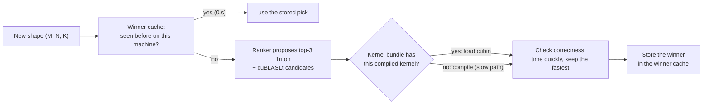
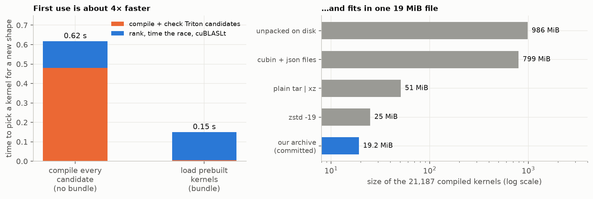

# 6. Shipping the selector: prebuilt kernels (cubin bundle) and the winner cache

A selector that takes a second to answer is fine for a program that runs for hours, but wasteful if every new matrix size pays a compile bill. This chapter is about how to make the first answer cheap on a machine that has never seen the shape.

## 6.1 The problem: compiling is most of the cost

To race its top-3 Triton candidates, the selector must first turn each candidate (a Python-level kernel plus its settings) into **GPU machine code**. That is Triton's **JIT compile**, about 0.13 s per kernel. Without any trick, compiling is **about two thirds** of the first-use time.

A **cubin** is the finished machine-code file for one kernel and one GPU architecture. If we compile every kernel the rankers could ever pick **once**, ahead of time, and ship the cubins, a new machine can *load* instead of *compile*.



## 6.2 What the bundle is

- **Contents.** Every kernel any of our two rankers (v1 and v2) can propose, plus 5 hand-picked configs: **1,176 configs**, each compiled for every way Triton can specialise its arguments (for example "this size is 1", "divisible by 16", "other"). That is **21,187 kernels**, built once in about 11 minutes on 10 CPU workers. We checked on 202,525 random shapes that none needs a kernel outside the set.
- **Why the obvious shortcut fails.** Triton's own cache cannot just be copied to another machine: its index files record absolute folder paths, so every entry would miss. A small custom cache manager (`kernels/bundle.py`) looks in this machine's cache, then in the read-only bundle, and **only then compiles**.
- **A miss costs time, never correctness.** If the bundle lacks a kernel, Triton compiles it as it always did. A bundle hit skips *compiling*, not *checking*: the correctness test still runs on every candidate.

## 6.3 What it buys



*Left: wall time to pick a kernel for a shape the process has never seen (10 unseen shapes, ranker v2, top-3 Triton + cuBLASLt top-16, empty Triton cache, one process per shape). Right: size of the compiled kernels.*

| | per new shape | Triton compile + check |
|---|---|---|
| Without the bundle | 0.618 s | 0.480 s |
| **With the bundle** | **0.150 s** | **0.005 s** |

- 32 bundle hits, 0 misses in that test. 9 of 10 shapes chose the same kernel with and without the bundle; the tenth was not investigated (the choice is a quick timing, so near-ties can flip between any two runs).
- **Coverage gate:** with the bundle installed and an empty user cache, all 777 suite and edge shapes times every runnable config (456,550 pairs, 14,229 distinct kernels) loaded with **0 compiles**, and 20 kernels were run for real and matched `torch.matmul`.
- **Size:** 21,187 kernels are 799 MiB as files (986 MiB on disk), too large to commit. We ship a **19.2 MiB archive** (`kernels/bundle.tar.xz`, plain `tar | xz` is 51 MiB, zstd 25 MiB) that the first call unpacks in about 11 s.
- A separate measurement on the held-out shapes gives the same picture for a richer search (top-5 + cuBLASLt proposals): about 0.8 s without the bundle, about 0.17 s with it. The 1.4 s one-time start-up of CUDA and cuBLASLt in a fresh process is not part of either number.

**Side effect on the router.** The family router (a small model that skips the Triton half of the race when cuBLASLt is clearly ahead) saves about 10% of first-use time, but only when Triton kernels really compile. With the bundle the Triton half is already cheap (about 0.06 s of 0.17 s), so the router is switched on automatically only when the bundle does not serve the kernels.

## 6.4 The winner cache

Even a 0.15 s search is wasted if the same shape comes back. The winner cache is a small file with **one line per searched shape**: the chosen kernel, keyed by GPU, Triton version, cuBLASLt version and driver. A repeat shape then costs nothing (no ranking, no compiling, no timing). It also decides the k policy of chapter 3: a shape called very often is searched again with k = 5 and the wider result replaces the narrower one.

## 6.5 What it does **not** do (limits)

| It is valid for | Otherwise |
|---|---|
| **Triton 3.7.1** (the compiler is hashed into every key) | every lookup misses; everything compiles, exactly as without a bundle |
| **GPU architecture sm_86** (RTX 3080, and 3090 by architecture) | same: the 2060 (sm_75) gets no hit |
| The current `kernels/triton_matmul.py` | same; rebuild after any edit |
| Kernels the **current rankers can propose** | a config outside the pool, or a retrained ranker's new picks, compile on first use; rebuild after retraining |
| fp16 | bf16 compiles on first use |
| 16-byte-aligned tensors, contiguous row-major | a sliced or transposed view compiles a new variant |

- The tiny C "launcher" Triton builds for each argument signature is **not** bundled; it depends on the Python and compiler version, so the first launches in a fresh process still build it.
- `install()` warns once when the fingerprint does not match and lets everything compile; `python -m tune bundle status` prints the reason. A bundle that matches the fingerprint but was built for an older ranker pool is **not** detected, so rebuild and repack after retraining.
- **Link to chapter 5.** The bundle is tied to an architecture, not to a model. The 3090 has the same architecture as the 3080, so the 3080's bundle should serve it, **but this was not checked** (the measurement commands, including the zero-shot runs of chapter 5, never install the bundle, so every compile cost they report is a true first use). The 2060 can never use it. A different architecture needs `bundle build` there (about 10 minutes on a machine with enough RAM), and the ranker and cuBLASLt parts must be refit as in 5.5.
- The winner cache is per machine and never expires by itself. A cuBLASLt winner is stored as a heuristic key; if the library no longer returns it, the shape is searched again. A stored winner comes from one short timing, so near-ties are as arbitrary as in the online search.

## 6.6 Reproduce

```bash
python -m tune bundle build                  # compile every kernel the pools can launch (GPU idle, resumable)
python -m tune bundle verify --per-shape 0   # gate: 0 compiles over every suite shape x runnable config
python -m tune bundle pack                   # writes kernels/bundle.tar.xz
python -m tune bundle status                 # does the bundle match this Triton / GPU?
```

Details and the full list of limits: `docs/kernel_bundle.md`. The measurements are from 2026-11-04 on the 3080 and are copied into `make_figures.py` (`fig_bundle`).

---
Previous: [5. Transferability](05_transferability.md)
