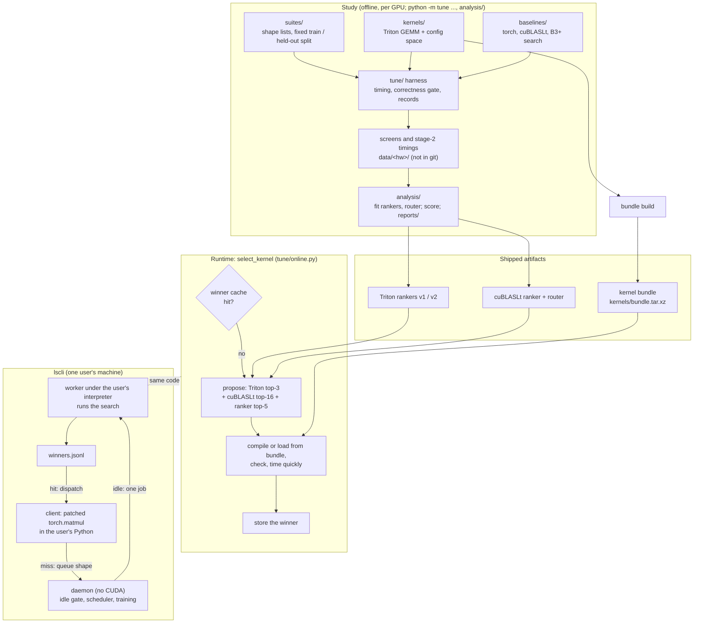

# 7. Deployment: the selector as a service (lscli), the system architecture, and how it is tested

Chapters 3 and 6 produce a function, `tune.online.select_kernel(ranker, M, N, K)`, that returns a good kernel for a shape in under a second. A real program does not call it: it calls `torch.matmul`. **lscli** (learned-selector CLI) closes that gap on one user's machine. It records which GEMM shapes the user's programs run, searches them while the GPU is idle, and on the next run sends those shapes to the stored winners. The contract is [`docs/lscli/spec.md`](../docs/lscli/spec.md); installing and trying it is in the [user guide](../docs/user_guide.md).

## 7.1 The whole system

The study pipeline (top) produces the models and the bundle; `select_kernel` (middle) is the selector that every experiment in chapters 3–6 measured; lscli (bottom) runs that same code on a user's machine. Every directory is described in the [developer guide, section 2](../docs/developer_guide.md#2-repository-map), and the selector's internals in [section 3](../docs/developer_guide.md#3-how-the-selector-works).

## 7.2 How lscli works

| Piece | Runs in | Does |
|---|---|---|
| **client** | the user's own Python (opt-in: `LSCLI_PATCH=1` or `lscli.enable()`) | counts shapes; for a shape with a stored winner, runs it instead of torch; otherwise runs torch and queues the shape |
| **daemon** | lscli's own environment, a `systemd --user` service | watches the GPU through NVML, opens an idle gate, schedules searches and (optionally) the training of this GPU's own models |
| **worker** | the user's interpreter, started by the daemon | runs one search (compile, check, time), so the winner is timed with the user's own torch / Triton / cuBLASLt |
| **CLI** | lscli's environment | `lscli status`, `cache ls`, `profile`, `pause`, `prewarm`, `doctor`, … |

Design rules, each forced by a failure it prevents:

- **The daemon never creates a CUDA context.** If it did, NVML would list it as a GPU user and its own idle gate would never open. Everything that touches the GPU runs in a separate job.
- **The idle gate** opens only when NVML lists no compute process and utilisation has stayed low for a set time, inside a time window (default 01:00–07:00), on AC power, and with no manual pipeline run holding the lock. A user process that appears during a job preempts it.
- **Winners are timed where they run.** A search runs under the interpreter that will use the winner, and the winner is written only after a final gate check, so a search disturbed by a user job is thrown away.
- **Torch stays the default.** A winner is dispatched only if it beat torch by the dispatch margin (4% and 5 µs at stock clocks): candidates closer than that are inside the short timing's noise ([2.4](02_baselines.md)). Any failure falls back to torch.
- **Without models, it still helps.** A fresh install ships the 3080's models as a zero-shot set (sm_86 only, [chapter 5](05_transferability.md)); on any other GPU, until its own models are trained in idle time, searches use cuBLASLt alone.
- **Daemon timings are not study data.** They run at stock clocks with no noise study, and are never written into `data/` or the reports.

## 7.3 What it costs a program

The patch adds host time to every `torch.matmul` call. The budget is tested (`tests/test_lscli_client.py::test_overhead`, median of 10,000 calls): at most +5 µs for a call that is not dispatched and +20 µs for a dispatched one. Measured on the RTX 2060 machine: +2.3 µs for an early exit (fp32), +3.7 µs for a late exit (fp16, non-contiguous), +13.5 µs for a dispatched call over a 36.9 µs Triton launch. For this reason dispatch is limited to kernels long enough that the launch runs ahead of the GPU.

## 7.4 How the code is tested

`tests/` holds **317 test functions in 24 files** (`python -m pytest -q`; more cases once parametrised). Most GPU tests need an idle GPU; the CPU-only files can run anywhere. By area:

| Area | Files | What is checked |
|---|---|---|
| Measurement | `test_timing`, `test_correctness`, `test_records_suites`, `test_sweep` | timer statistics and modes, the correctness gate catches wrong results (including fp16 accumulation), records and resume keys, the suites' split rules, the sweep's shape subset, worker sizing and recovery when compile workers die |
| Kernels | `test_kernels`, `test_bundle` | the Triton GEMM against the fp32 reference over edge shapes; the bundle's lookup order, specialisation list, fingerprint and a round trip through Triton |
| Selectors and models | `test_learned`, `test_selectors`, `test_portfolio`, `test_cublaslt_knn`, `test_lt_rank_portable`, `test_online_split`, `test_fresh_suite` | ranker features and grouped CV; no held-out or fresh shape leaks into any fit; the foreign-GPU guards; the search split into a ranking half and a GPU half |
| Runtime cache | `test_winner_cache` (41 tests) | current / soft-stale / hard-stale tiers, a retrained model makes old winners stale, damaged lines and another writer's lines, wider-search replacement, compaction that never drops another environment's line, a broken cache never breaks selection |
| Scoring | `test_ranker_compare`, `test_cross_gpu`, `test_zero_shot` | the oracle includes every timed family (the two scorer bugs of chapter 5 each got a regression test) |
| lscli | `test_lscli_core`, `test_lscli_client`, `test_lscli_daemon`, `test_lscli_worker`, `test_lscli_training`, `test_lscli_guard`, `test_lscli_install` | file formats and CLI; the patch, its dispatch rule and overhead budget; the gate, preemption and an **end-to-end search on the GPU** (a miss is queued, the daemon searches it, the next run dispatches it); training orchestration; the installer in a sandboxed home |

Where to run which tests, and how to try an lscli change for real: [developer guide 6.1](../docs/developer_guide.md#61-run-the-tests) and [section 7](../docs/developer_guide.md#7-working-on-lscli).

## 7.5 Limits of the deployment (v1)

- **NN layout, fp16, one GPU.** `nn.Linear` / `F.linear` (an NT layout) are counted but never dispatched, so most model layers are not sped up yet. bf16 is dispatched but unvalidated (models and bundle are fp16). Only device 0 is used.
- **Winners are timed idle and served under load**, and candidates within the short timing's noise (about 4% at stock clocks) are arbitrary, which is why torch is kept unless the winner is clearly faster.
- **The idle gate cannot tell an idle program that holds a CUDA context** (an open notebook) from a busy one, so such a program keeps background work from running.
- A user process that starts during a daemon job shares the GPU with it for up to about 6 s; run `lscli pause` before a measurement that matters.
- The full list is in [spec section 9](../docs/lscli/spec.md#9-known-limitations-v1); open work in the [developer guide, section 8](../docs/developer_guide.md#8-open-items).

---
Previous: [6. Shipping](06_shipping.md) · Back to [README](README.md)
