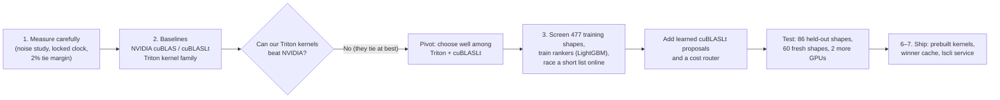

# Learned kernel selection for GPU matrix multiplication: results

**In one paragraph.** A GPU can run a matrix multiplication (GEMM) with thousands of different kernel configurations, and the fastest one depends on the matrix sizes. We built a selector that, the first time a program meets a new size, ranks the candidates with learned models, times a short list on the GPU and keeps the fastest, in under a second (0.15–0.2 s with prebuilt kernels). On 86 held-out sizes it lands a median **0.5%** from the best candidate available to it (worst 5%: 5.5%). It is faster than NVIDIA's default choice on most sizes and never slower beyond noise, and it ties NVIDIA's 20-second offline search. It does **not** beat that offline search on kernels of 50 µs or more, so the project is a selection result, not a faster kernel. The selector runs as a background service (**lscli**) that speeds up `torch.matmul` without code changes.

This folder is the write-up for a reader who wants the question, the method, the evidence and the limits, in order. Each chapter answers one question; the numbers come from the dated entries of [`reports/week1.md`](../reports/week1.md) (the lab notebook), and the code is described in the [developer guide](../docs/developer_guide.md).

| Chapter | Question it answers |
|---|---|
| [1. Background](01_background.md) | What is a kernel selector? How does a GPU run a GEMM? Why does the GPU model matter? |
| [2. Baselines](02_baselines.md) | What do we compare against? How noisy is the measurement? What did we find before using any ML? |
| [3. Model training](03_model_training.md) | What did we train, how well does it pick on unseen and fresh sizes, and how does it join NVIDIA's own options? |
| [4. Shapes](04_shapes.md) | Which matrix sizes did we use, and how are training and test kept apart? |
| [5. Transferability](05_transferability.md) | Does it work on other GPUs (RTX 3090, RTX 2060), retrained and with the model copied unchanged (zero-shot)? |
| [6. Shipping](06_shipping.md) | How is the first answer made cheap on a new machine (prebuilt kernels, winner cache)? |
| [7. Deployment](07_deployment.md) | How does it reach a real program (lscli)? What is the system architecture, and how is it tested? |

## The story in one diagram

## Key numbers

RTX 3080 and the 86 held-out shapes unless the row says otherwise. "Regret" is how much slower than the best candidate; p95 / p99 are the unlucky 5% / worst 1% of shapes.

| Finding | Number | Chapter |
|---|---|---|
| Valid configs in our Triton kernel family | 10,840 (of 19,200) | 1 |
| Different configs that win somewhere | 332, over 563 screened shapes | 1 |
| Our family at its best vs the searched cuBLASLt (B3+) | median 0.99× (98.8%), a tie | 2 |
| One fixed config for every shape | median **+49%**, p95 **+486%**, p99 **+948%** | 2 |
| Smallest trustworthy difference (tie margin) | 2% for kernels ≥ 50 µs, 5% below; still 2% across sessions with the clock unlocked | 2 |
| Learned Triton ranker, one pick | median +2.4%, p95 +18%, p99 +24% | 3 |
| Ranker + race a diverse top-3 (~0.4 s first use) | median **+1.1%**, p95 **+9.1%**, p99 **+20%** | 3 |
| Ranker v2 (roofline features), Triton only, top-3 | median +0.2%, p95 +4.6%, p99 +9.6% | 3 |
| **Shipped selector**: v2 top-3 + cuBLASLt top-16 + cuBLASLt ranker top-5 | median **0.5%**, p95 **5.5%**, p99 **8.4%**; 5 shapes > 5% off; slower than B3+ on 7 of 86 | 3 |
| Same, vs NVIDIA's default (B2) | faster on 49 of 86, slower on 0 (median 0.90×; heuristic-only pool) | 3 |
| Same, vs B3+ | tie at ≥ 50 µs (1.001×, 4 faster / 6 slower of 30); 0.951× below 50 µs | 3 |
| **60 fresh shapes** (generated after every choice was frozen) | median 0.6%, p95 5.6%, p99 12.8%; faster than B2 on 42, slower on 1 | 3 |
| Cost router (when kernels must compile) | first use −10 to −13%, quality unchanged | 3 |
| RTX 3090, 3080 model unchanged (zero-shot) | **works**: 0 of 27 picks > 50% off; v2 within noise of the 3080's own | 5 |
| RTX 3090, retrained | joint race faster than B2 on 61 of 86, slower on 0; G4 still fails | 5 |
| RTX 2060, retrained / zero-shot | selector as good as on the 3080, but Triton has no tensor-core path (0.44× of B3+); zero-shot **fails** (13–16 of 27 picks > 50% off) | 5 |
| Prebuilt kernels (bundle) | first use per new shape 0.62 s → **0.15–0.20 s**; same picks and byte-identical kernels (A/B rerun, 30 shapes); 30,327 kernels in a 25 MiB archive; Triton 3.7.1 on sm_86 only | 6 |
| lscli overhead per `torch.matmul` call | +2–4 µs not dispatched, +13.5 µs dispatched (budgets 5 / 20 µs, tested) | 7 |

## Gates (decided before the results, `plan.md` §8.2)

| Gate | Question | Result |
|---|---|---|
| G1 | Is the timing trustworthy? | **Pass** for kernels ≥ 50 µs (2% margin) |
| G2 | Is our Triton family ≥ 90% as fast as B3+? | **Pass** (98.8%) on the 3080 and 3090; fails on the 2060 (no tensor cores in Triton's code there) |
| G3 | Does choosing per shape beat one fixed config? | **Pass** (one config is a median 48–74% slower) |
| G4 | Does it beat B3+ where it matters (≥ 50 µs)? | **Fail** on every GPU; a narrow pass for tiny GEMMs |
| G5 | Is a small fixed menu of configs enough? | Pass on training shapes, **fails on unseen ones** (p95 stays 8–11%), which is why the selector is learned |

Conclusion: **not viable as a cuBLAS competitor on this GPU, viable as a selection project.**

## Where the numbers come from

- **Source of every number:** the dated entries of [`reports/week1.md`](../reports/week1.md) and the generated tables in [`reports/`](../reports/), which name the session ids, row counts and the commands that reproduce them. Raw data lives in `data/<hw>/` (machine-specific, not in git); small copies are in `reports/snapshot/`.
- **Conditions:** RTX 3080, SM clock locked at 1755 MHz, driver 595.99.02, Triton 3.7.1, torch 2.13.0 + CUDA 13.0, cold L2, 3 memory placements pooled ([`docs/methodology.md`](../docs/methodology.md); before 2026-11-20 inputs of ≤ 1 MiB were not actually moved, which a same-day A/B showed changes no result, [chapter 2](02_baselines.md)). The RTX 3090 ran on a cluster node with the clock unlocked and driver 590.48, so compare its ratios and regrets, never its absolute times.
- **Figures** in `figures/` are drawn by `python results/make_figures.py` (CPU only). Most values are read from the result files; a few small tables that exist only as text in `reports/` or `docs/` are typed into the script, each with its source named beside it. The bundle A/B of chapter 6 is re-run with `python results/bundle_ab.py` (GPU).
- **Reading percentiles:** with 86 shapes p95 is set by the 4–5 worst shapes and p99 by one or two; with 27 or 60 shapes p99 is the single worst shape. Differences within the tie margin are ties.

## Glossary

- **GEMM**: matrix multiplication, `C = A × B`. Its **shape** is (M, N, K).
- **Kernel / config**: the GPU program, and one set of its settings (tile sizes, warps, pipeline stages, split-K).
- **Oracle**: the best config for a shape, found by trying all of them.
- **Regret**: `time(chosen) / time(oracle) − 1`; 0% is perfect.
- **Held-out / fresh shapes**: test shapes never used for training; fresh shapes were also generated after every design choice was made.
- **cuBLAS / cuBLASLt**: NVIDIA's matrix-multiply libraries. **B2** = cuBLASLt's default pick, **B3** = best of its suggested list, **B3+** = best after a 20-second search per shape.
- **Triton**: a Python language and compiler for GPU kernels; our kernel family is written in it.
- **Zero-shot**: using a model trained on one GPU on another without retraining.
- **p95 / p99**: 95 / 99 of 100 shapes are at least this good.

---
Start reading: [1. Background](01_background.md)
