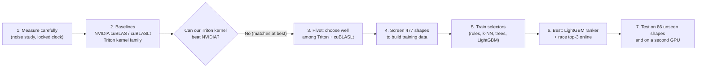

# Learned kernel selection for GPU matrix multiplication: summary

**One-sentence version:** a GPU can multiply two matrices in thousands of different ways, and the best way depends on the matrix sizes. We built a small program that picks a good way in under a second. On the sizes we tested it picks within about 1% of the best on a typical case, and it is never worse than NVIDIA's default choice. It does not beat NVIDIA's best offline-searched code.

| Chapter | Question it answers |
|---|---|
| [1. Background](01_background.md) | What is a kernel selector? How does a GPU run this? Why does the GPU model matter? |
| [2. Baselines](02_baselines.md) | What do we compare against, and what did we find before using any ML? |
| [3. Model training](03_model_training.md) | What did we train, how well does it pick, does it work on another GPU? |
| [4. Shapes](04_shapes.md) | Which matrix sizes did we use, and why? How are train and test separated? |

## The whole story in one diagram

## Key numbers (RTX 3080, 86 unseen test shapes)

| Finding | Number |
|---|---|
| Valid configs in our Triton kernel family | 10,840 |
| Different configs that win somewhere | 332 of 563 screened shapes |
| Our family vs the best cuBLASLt (median) | 0.99× (a tie) |
| One fixed config for every shape | typical **+49%** slower than the best, unlucky 5% **+486%**, worst 1% **+948%** |
| Learned ranker, pick 1 | +2.4% typical, +18% unlucky 5%, +24% worst 1% |
| Ranker, diverse top-3 raced online (about 0.4 s first use) | **+1.1%** typical, **+9.1%** unlucky 5%, **+20%** worst 1% |
| Ranker v2, Triton only, top-3 | +0.2% typical, +4.6% unlucky 5%, +9.6% worst 1% (vs the best Triton config) |
| Joint race, Triton top-3 + cuBLASLt top-16 (~0.7 s) vs NVIDIA's default | faster on 49 of 86 shapes, slower on 0 |
| Same, vs NVIDIA's 20-second offline search | level on the median, slower on 14 of 86 |
| Second GPU (RTX 2060) | the selector works as well, but Triton itself is much slower there (0.43× of cuBLASLt) |

All figures are in `figures/` and are rebuilt with `python results/make_figures.py` (CPU only, never touches the GPU).

## Short glossary

- **GEMM**: matrix multiplication, `C = A × B`.
- **Kernel**: the program that runs on the GPU.
- **Config**: one set of kernel settings (tile size, warps, …).
- **Oracle**: the best config for a shape, found by trying all of them.
- **Regret**: how much slower than the oracle, as a percentage.
- **Held-out / unseen shapes**: test shapes never used for training.
- **cuBLAS / cuBLASLt**: NVIDIA's own matrix-multiply libraries. **B3+** is cuBLASLt with a 20-second search per shape.
- **Triton**: a Python tool for writing GPU kernels.
- **p95 ("unlucky 5%")**: 95 out of 100 shapes are at least this good.
- **p99 ("worst 1%")**: 99 out of 100 shapes are at least this good. With 86 test shapes this is essentially the single worst shape (or the worst two), so it answers "how bad can one pick be?".

## Assumptions I made (tell me if any are wrong)

1. **Read-only.** I summarised the results that already exist in `reports/` and `data/`. I did not run anything on the GPU and did not change any project file outside `results/`.
2. **Audience.** I wrote for a secondary-school reader. Technical detail lives in `reports/week1.md` and `AGENTS.md`.
3. **Scope.** The summary covers the RTX 3080 work plus the first RTX 2060 comparison. It includes rank v2 and the joint cuBLASLt search, which are the latest results.
4. **Hand-copied numbers.** A few small tables exist only as text in `reports/` (noise before/after pooling, v1 vs v2, the joint-race counts, the 2060 comparison). They are typed into `make_figures.py` with the source named beside each. All the others are read from the result files.
5. **Rounding.** Percentages are rounded. The unlucky-5% numbers depend on only a handful of shapes (86 test shapes means about the 4 worst), and the worst-1% numbers on one or two, so treat them as rough. The figures in `figures/` still draw median, mean and p95 only; the worst-1% numbers are in the tables.
6. **Not a final claim.** `reports/week1.md` and `AGENTS.md` still show uncommitted edits (git status at the start), so these results match the working tree, not a committed snapshot.
