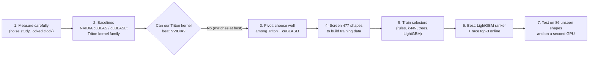

# Learned kernel selection for GPU matrix multiplication: summary

**One-sentence version:** a GPU can multiply two matrices in thousands of different ways, and the best way depends on the matrix sizes. We built a small program that picks a good way in under a second. On the sizes we tested it picks within about 1% of the best on a typical case, and it is never worse than NVIDIA's default choice. It does not beat NVIDIA's best offline-searched code.

| Chapter | Question it answers |
|---|---|
| [1. Background](01_background.md) | What is a kernel selector? How does a GPU run this? Why does the GPU model matter? |
| [2. Baselines](02_baselines.md) | What do we compare against, and what did we find before using any ML? |
| [3. Model training](03_model_training.md) | What did we train, how well does it pick, does it work on another GPU? |
| [4. Shapes](04_shapes.md) | Which matrix sizes did we use, and why? How are train and test separated? |
| [5. Transferability](05_transferability.md) | Does the selector work on other GPUs (RTX 3090, RTX 2060)? What if we copy the trained model unchanged (zero-shot)? |
| [6. Shipping](06_shipping.md) | How do we make the first answer cheap on a new machine? (prebuilt kernels = cubin bundle, winner cache) |

## The whole story in one diagram

## Key numbers (RTX 3080 and 86 unseen test shapes, unless the row names another GPU; other GPUs use the 27 shared test shapes)

| Finding | Number |
|---|---|
| Valid configs in our Triton kernel family | 10,840 |
| Different configs that win somewhere | 332 of 563 screened shapes |
| Our family vs the best cuBLASLt (median) | 0.99× (a tie) |
| One fixed config for every shape | typical **+49%** slower than the best, unlucky 5% **+486%**, worst 1% **+948%** |
| Learned ranker, pick 1 | +2.4% typical, +18% unlucky 5%, +24% worst 1% |
| Ranker, diverse top-3 raced online (about 0.4 s first use) | **+1.1%** typical, **+9.1%** unlucky 5%, **+20%** worst 1% |
| Ranker v2, Triton only, top-3 | +0.2% typical, +4.6% unlucky 5%, +9.6% worst 1% (vs the best Triton config) |
| Joint race, Triton top-3 + cuBLASLt top-16 (~0.7 s) vs NVIDIA's default | faster on 49 of 86 shapes, slower on 0 |
| Same, vs NVIDIA's 20-second offline search | level on the median, slower on 14 of 86 |
| Second GPU (RTX 2060), retrained | the selector works as well (typical +0.7%), but Triton itself is much slower there (0.44× of cuBLASLt) |
| 2060, 3080 model used unchanged (zero-shot) | **fails**: 13 to 16 of 27 picks are more than 50% off (no tensor-core code in Triton on that chip, so a confound) |
| Third GPU (RTX 3090), 3080 model unchanged (zero-shot) | **works**: 0 of 27 picks more than 50% off; the v2 model matches the 3080's own (typical +0.9%) |
| 3090, retrained from scratch | joint race faster than NVIDIA's default on 61 of 86 shapes, slower on 0; its timing noise is about 4–5% (3080: 2%) |
| Prebuilt kernels (cubin bundle) | first use per new shape 0.62 s → **0.15 s**; ships as a 19 MiB archive; only valid for Triton 3.7.1 on sm_86 chips |

All figures are in `figures/` and are rebuilt with `python results/make_figures.py` (CPU only, never touches the GPU).

## Short glossary

- **GEMM**: matrix multiplication, `C = A × B`.
- **Kernel**: the program that runs on the GPU.
- **Config**: one set of kernel settings (tile size, warps, …).
- **Oracle**: the best config for a shape, found by trying all of them.
- **Regret**: how much slower than the oracle, as a percentage.
- **Held-out / unseen shapes**: test shapes never used for training.
- **cuBLAS / cuBLASLt**: NVIDIA's own matrix-multiply libraries. **B3+** is cuBLASLt with a 20-second search per shape.
- **Triton**: a Python tool for writing GPU kernels.
- **p95 ("unlucky 5%")**: 95 out of 100 shapes are at least this good.
- **p99 ("worst 1%")**: 99 out of 100 shapes are at least this good. With 86 test shapes this is essentially the single worst shape (or the worst two), so it answers "how bad can one pick be?".

## Assumptions I made (tell me if any are wrong)

1. **Read-only.** I summarised the results that already exist in `reports/` and `data/`. I did not run anything on the GPU and did not change any project file outside `results/`.
2. **Audience.** I wrote for a secondary-school reader. Technical detail lives in `reports/week1.md` and `AGENTS.md`.
3. **Scope.** The summary covers the RTX 3080 work, the RTX 2060 and RTX 3090 transfer tests (retrained and zero-shot, chapter 5), and the prebuilt-kernel bundle and winner cache (chapter 6). It includes rank v2 and the joint cuBLASLt search. Chapters 5 and 6 were added on 2026-11-10 from the `reports/week1.md` entries up to 2026-11-09 (commit `f25dea0`).
4. **Hand-copied numbers.** A few small tables exist only as text in `reports/` (noise before/after pooling, v1 vs v2, the joint-race counts, the 2060 and 3090 comparisons, the 3090 noise floor, the bundle timings and sizes). They are typed into `make_figures.py` with the source named beside each. All the others are read from the result files.
5. **Rounding.** Percentages are rounded. The unlucky-5% numbers depend on only a handful of shapes (86 test shapes means about the 4 worst), and the worst-1% numbers on one or two, so treat them as rough. The figures in `figures/` still draw median, mean and p95 only; the worst-1% numbers are in the tables.
6. **Not a final claim.** The 3090 numbers come from an unlocked clock and a different driver, and the transfer tests use only 27 shared shapes. The bundle timings are from the 3080 on 2026-11-04. Nothing was re-measured for chapters 5 and 6; the 3090 was not checked against the 3080's bundle.
